# Dev-Workstation - 내 컴퓨터에 개발자용 '작업실' 꾸미기

본 프로젝트는 리눅스 CLI(터미널), Git/GitHub(버전 관리 및 협업), Docker(컨테이너 가상화)를 손수 세팅하여 "내 컴퓨터에서만 돌아가는 코드"의 문제를 해결하고, 팀원 누구나 재현 가능한(Reproducible) 개발 워크스테이션 환경을 구축한 결과 보고서입니다.

---

## 1. 프로젝트 개요

- **프로젝트명**: Dev-Workstation (개발자용 작업실 환경 구축)
- **과제 분야**: 코디세이 입학연수 / 개발 입문 미션 01
- **수행 목적**: 
  1. 리눅스 CLI 기반의 디렉터리 탐색, 파일 CRUD 및 권한(Permission) 체계 이해
  2. Docker 가상화 기술을 이용한 격리된 실행 환경 구성 및 컨테이너 라이프사이클 관리
  3. `Dockerfile` 기반 커스텀 웹 서버 제작, 포트 매핑, 바인드 마운트 및 볼륨 영속성 실증
  4. Git과 GitHub를 활용한 버전 관리, 브랜치/원격 연동 및 트러블슈팅 역량 배양
- **제출 저장소**: https://github.com/haru2014/at01

---

## 2. 실행 환경

| 항목 | 구성 사양 | 비고 |
|---|---|---|
| **Host OS** | Windows 11 Home / Pro | 로컬 호스트 머신 |
| **Guest OS (WSL)** | WSL 2 (Ubuntu Linux) | 커널 6.18.54.1-microsoft-standard |
| **Shell & Terminal** | Bash / PowerShell 7.7.0 | Windows Terminal |
| **Docker Engine** | Docker Desktop 29.9.2 (build a82e528) | WSL 2 Engine Backend |
| **Git & IDE** | Git 2.56.0 / Antigravity IDE & VS Code | SSH 키 기반 인증 연동 |

---

## 3. 수행 항목 체크리스트

- [x] **터미널 기본 조작**: 현재 위치 확인, 목록 확인(숨김 파일 포함), 생성, 복사, 이동, 삭제 (`과제01`~`과제10`)
- [x] **권한 실습**: 파일(`600` ↔ `644`) 및 디렉터리(`700` ↔ `755`) 권한 변경 실험 및 전/후 비교 (`과제11`~`과제16`)
- [x] **Docker 설치 및 점검**: `docker --version`, `docker info` 및 데몬 상태 점검 (`과제17`~`과제25`)
- [x] **기본 컨테이너 라이프사이클**: `hello-world`, `docker images`, `ubuntu` 인터랙티브 진입, `logs`, `stats` 모니터링 (`과제26`~`37`)
- [x] **Dockerfile 커스텀 이미지 제작**: `nginx:alpine` 기반 커스텀 인덱스 페이지 탑재 및 빌드 (`38`~`43`)
- [x] **포트 매핑 접속 검증**: 다중 포트(`8080`, `8081`) 컨테이너 구동 및 브라우저/curl 접속 증빙 (`44`~`47`)
- [x] **바인드 마운트 실시간 반영**: 호스트 파일 수정 시 무중단 즉시 반영 검증 (`48`~`51`)
- [x] **볼륨 데이터 영속성 검증**: Docker 볼륨 생성, 컨테이너 삭제 후 신규 컨테이너에서 데이터 유지 증명 (`52`~`55`)
- [x] **볼륨 백업 및 복원 정책**: tar 기반 볼륨 아카이빙/복원 및 Cron 스케줄러 정책 수립
- [x] **포트 충돌 진단 및 해결**: `ss`/`lsof`/`netstat` 점유 진단 및 실제 프로세스 해제 절차 명문화
- [x] **트러블슈팅 분석 (3건)**: Docker 소켓 권한 오류, Git non-fast-forward 충돌, 컨테이너 이름 충돌 해결
- [x] **보안 수칙 준수**: 개인정보, 토큰, 비밀번호 마스킹 및 민감 정보 격리

---

## 4. 핵심 기술 개념 Q&A

### Q1. 절대 경로와 상대 경로의 차이는 무엇인가요?
- **절대 경로 (Absolute Path)**: 최상위 루트 디렉터리(`/` 또는 `C:\`)를 기점으로 대상의 고유한 전체 위치를 명시하는 방식입니다. (예: `/home/haru2014/my-dev-workspace/site/index.html`) 현재 위치와 무관하게 항상 동일한 대상을 가리킵니다.
- **상대 경로 (Relative Path)**: 현재 작업 디렉터리(`.` 또는 `pwd`)를 기준으로 대상을 상대적으로 지정하는 방식입니다. (예: `./site/index.html`, `../practice.txt`) 특정 사용자 PC 환경에 종속되지 않고 이식성 높은 코드를 작성하기 위해 상대 경로 사용을 강력히 권장합니다.
- **[참고] OS별 경로 변환**: Windows 경로(`C:\Users\...`)를 WSL 내부에서 사용할 때는 `/mnt/c/Users/...` 또는 `wslpath -u "<WindowsPath>"` 명령어를 사용하여 Linux 표준 경로로 상호 변환합니다.

### Q2. 파일 권한의 의미(r/w/x)와 755, 644 표기는 어떤 규칙으로 해석되나요?
- 권한은 읽기(`r`=4), 쓰기(`w`=2), 실행(`x`=1)의 3비트 8진수 합산으로 구성되며, **소유자(User) / 소유그룹(Group) / 기타사용자(Others)**의 3단계로 지정됩니다.
- **`755` (`rwxr-xr-x`)**:
  - 소유자: 4 + 2 + 1 = 7 (`rwx`, 읽기/쓰기/실행 전체 허용)
  - 그룹: 4 + 0 + 1 = 5 (`r-x`, 읽기/실행 허용)
  - 기타: 4 + 0 + 1 = 5 (`r-x`, 읽기/실행 허용)
  - **용도**: 디렉터리(진입 및 탐색을 위해 실행 `x` 권한 필수)나 실행 스크립트에 적용합니다.
- **`644` (`rw-r--r--`)**:
  - 소유자: 4 + 2 + 0 = 6 (`rw-`, 읽기/쓰기 허용)
  - 그룹: 4 + 0 + 0 = 4 (`r--`, 읽기 전용)
  - 기타: 4 + 0 + 0 = 4 (`r--`, 읽기 전용)
  - **용도**: 일반 텍스트 문서, HTML/CSS 웹 리소스, 소스코드의 표준 권한입니다.
- **`600` (`rw-------`)**: 소유자만 읽고 쓸 수 있으며, 외부 노출 시 보안 위험이 큰 SSH 개인키(`id_rsa`), API 토큰 파일 등에 적용합니다.
- **[참고] 특수 권한 비트 (Special Permissions)**:
  - **SetUID (4000)**: 실행 시 소유자의 권한으로 프로세스 실행 (예: `chmod 4755 /usr/bin/passwd`)
  - **SetGID (2000)**: 실행 시 그룹 소유자의 권한으로 실행되거나 하위 디렉터리 파일에 그룹 상속
  - **Sticky Bit (1000)**: 모든 사용자가 쓸 수 있는 공용 디렉터리(`/tmp`)에서 파일 소유자만 삭제 가능하도록 제한 (`chmod 1777 /tmp`)

### Q3. 기존 Dockerfile 기반 커스텀 이미지 제작 원리와 이미지 vs 컨테이너 차이는?
- **빌드 원리**: Dockerfile은 베이스 이미지(`FROM`)를 시작으로 각 지시어(`LABEL`, `ENV`, `COPY`, `RUN` 등)가 실행될 때마다 읽기 전용 레이어(Read-Only Layer)를 순차적으로 빌드하여 캐싱합니다.
- **이미지와 컨테이너의 차이**:
  - **이미지 (Image)**: 실행에 필요한 코드, 런타임, 시스템 도구가 불변(Immutable) 상태로 패키징된 '설계도(붕어빵 틀)'입니다.
  - **컨테이너 (Container)**: 이미지의 불변 레이어 위에 얇은 읽기/쓰기 레이어(Thin R/W Layer)를 얹어 메모리상에 독립 격리 구동된 '실행 인스턴스(붕어빵)'입니다.
  - **불변성 실증 예시**: 컨테이너 내부에서 파일을 생성하거나 수정하더라도 원본 이미지는 전혀 변하지 않으며, 새 컨테이너를 실행하면 언제나 깨끗한 초기 상태의 이미지가 재현됩니다.

### Q4. 포트 매핑(Port Forwarding)이 필요한 이유와 호스트 바인딩 주소의 의미는?
- **필요성**: 컨테이너는 호스트 OS와 격리된 사설 가상 네트워크 네임스페이스(veth 쌍)를 가집니다. 따라서 외부나 호스트 브라우저에서 컨테이너 내부 포트에 접근하려면 `-p <호스트포트>:<컨테이너포트>`로 주소 변환(NAT 포트 포워딩) 규칙을 설정해야 합니다.
- **호스트 바인딩 주소 비교 및 보안**:
  - `127.0.0.1:8080:80` (로컬 루프백 바인딩): 호스트 PC 내부에서만 접속 가능하며, 외부 LAN이나 공용 인터넷에서의 임의 접근을 차단하여 로컬 개발 시 매우 안전합니다.
  - `0.0.0.0:8080:80` (모든 인터페이스 바인딩): 로컬 PC뿐 아니라 동일 네트워크 대역의 외부 기기에서도 접근 가능하므로 프로덕션 배포 시에는 반드시 방화벽(UFW, 클라우드 Security Group) 설정이 수반되어야 합니다.

### Q5. Docker 볼륨(영속 데이터)의 원리와 바인드 마운트와의 차이는 무엇인가요?
- **컨테이너 레이어의 휘발성**: 컨테이너 내부에서 기록된 데이터는 컨테이너 삭제(`docker rm`) 시 함께 소멸합니다(Stateless).
- **Docker Volume**: Docker 엔진이 직접 관리하는 호스트 파일시스템의 특정 영역(`/var/lib/docker/volumes/`)에 저장소를 할당합니다. 컨테이너가 생성·삭제되어도 볼륨은 독립적으로 영구 보존되므로 데이터베이스나 상태 데이터 보존에 최적화되어 있습니다.
- **바인드 마운트 (Bind Mount)**: 호스트의 임의의 디렉터리 경로를 컨테이너 내부 경로와 직접 1:1로 연결합니다. 호스트에서 소스 코드를 수정하면 컨테이너를 재빌드하지 않아도 즉각 반영되므로 로컬 개발 및 디버깅에 유리합니다.

### Q6. Git과 GitHub의 역할 차이는 무엇인가요?
- **Git**: 개발자의 로컬 컴퓨터에서 코드의 변경 이력(버전)을 기록, 추적하고 독립적인 브랜치 분기 및 병합을 지원하는 **분산 버전 관리 시스템(DVCS) 도구**입니다.
- **GitHub**: Git으로 관리되는 로컬 저장소들을 인터넷 클라우드에 호스팅하여 원격 백업, 팀원 간 코드 공유, 코드 리뷰(Pull Request), 이슈 추적 및 CI/CD 자동화를 제공하는 **웹 기반 협업 플랫폼**입니다.

---

## 5. 프로젝트 디렉터리 구조

### 5.1 디렉터리 트리
```text
at01/
├── Dockerfile                   # 커스텀 Nginx 웹 서버 빌드 명세서
├── README.md                    # 본 과제 미션 보고서 (단일 출처 기술 문서)
├── # 개발 환경 구축 미션 수행 기획서.txt # 사전 기획 및 분석 보고서
├── 미션01.txt                   # 미션 요구사항 원본
├── .gitignore                   # 민감 정보 및 임시 파일 제외 목록
├── site/                        # 웹 서버 정적 콘텐츠
│   └── index.html               # 커스텀 웹 페이지
└── 스샷/                        # 전 과정 검증 증빙 캡처 (총 55개)
    ├── 과제01.png ~ 과제26.png   # 터미널 실습, 권한, Docker 설치 및 기초 운영
    └── 27.png ~ 55.png          # 컨테이너 심화, Dockerfile 빌드, 포트/마운트/볼륨 검증
```

### 5.2 주요 파일 및 디렉터리 역할 요약
| 디렉터리 / 파일명 | 역할 및 목적 요약 |
|---|---|
| `Dockerfile` | `nginx:alpine` 기반 정적 웹 리소스 탑재 및 포트 노출 빌드 스크립트 |
| `site/` | 웹 서버에서 호스팅할 HTML 정적 콘텐츠 디렉터리 (바인드 마운트 대상) |
| `site/index.html` | "Hello Codyssey!" 환영 문구 및 Nginx 구동 정보를 담은 커스텀 웹 페이지 |
| `스샷/` | 터미널 CLI 실행 로그, 웹 브라우저 접속 화면 등 과제 전 과정 증빙 자료 (55장) |
| `README.md` | 기획, 환경, 개념 Q&A, 수행 로그, 트러블슈팅, 백업 정책을 총망라한 기술 문서 |
| `.gitignore` | 개인 인증키, OS 캐시, 임시 파일이 Git에 추적되지 않도록 방어하는 설정 파일 |

---

## 6. 단계별 미션 수행 결과 및 증빙 보고서

### 6.1 터미널 CLI 파일 시스템 조작 실습

리눅스 CLI 기본 명령어를 활용하여 경로 탐색 및 디렉터리/파일 CRUD 작업을 수행했습니다.

```bash
# 1. 홈 디렉터리 이동 및 현재 경로 확인 (과제02.png)
haru2014@LAPTOP-9TEESRNC:~$ cd ~
haru2014@LAPTOP-9TEESRNC:~$ pwd
/home/haru2014

# 2. 작업 디렉터리 생성 및 진입 (과제03.png)
haru2014@LAPTOP-9TEESRNC:~$ mkdir my-dev-workspace
haru2014@LAPTOP-9TEESRNC:~$ cd my-dev-workspace
haru2014@LAPTOP-9TEESRNC:~/my-dev-workspace$ pwd
/home/haru2014/my-dev-workspace

# 3. 파일 생성 및 내용 기록/확인 (과제06.png, 과제07.png)
haru2014@LAPTOP-9TEESRNC:~/my-dev-workspace$ touch practice.txt
haru2014@LAPTOP-9TEESRNC:~/my-dev-workspace$ echo "Hello Codyssey" > practice.txt
haru2014@LAPTOP-9TEESRNC:~/my-dev-workspace$ cat practice.txt
Hello Codyssey

# 4. 파일 복사, 이름 변경 및 대화형 삭제 (과제08.png ~ 과제10.png)
haru2014@LAPTOP-9TEESRNC:~/my-dev-workspace$ cp practice.txt practice-copy.txt
haru2014@LAPTOP-9TEESRNC:~/my-dev-workspace$ mv practice-copy.txt practice-backup.txt
haru2014@LAPTOP-9TEESRNC:~/my-dev-workspace$ rm -i practice-backup.txt
rm: remove regular file 'practice-backup.txt'? y
```

| 검증 단계 | 수행 내용 | 증빙 스크린샷 및 캡션 |
|---|---|:---:|
| **WSL 설치 및 사용자 생성** | Ubuntu 설치 및 `haru2014` 계정 초기화 | 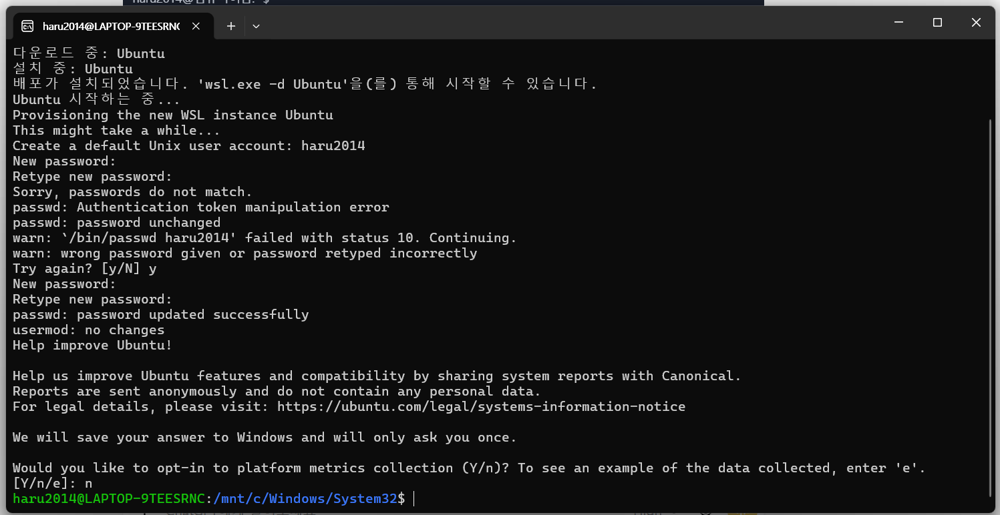<br>*(캡션: WSL 2 Ubuntu 설치 및 기본 유닉스 계정 설정)* |
| **디렉터리 생성 및 경로 확인** | `mkdir my-dev-workspace`, `cd`, `pwd`, `ls -la` | 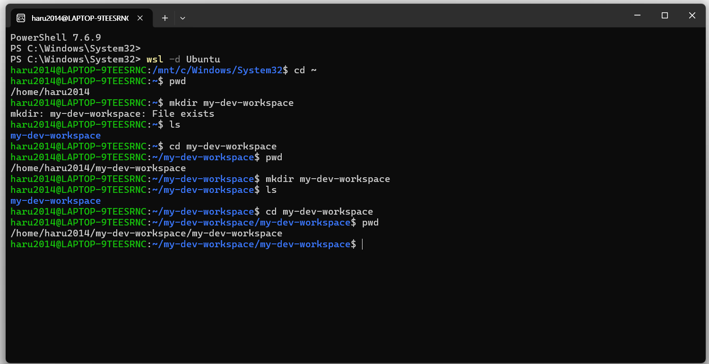<br>*(캡션: 작업 디렉터리 생성 및 pwd 경로 검증)* |
| **파일 생성 및 내용 조회** | `touch practice.txt`, `echo >`, `cat` | 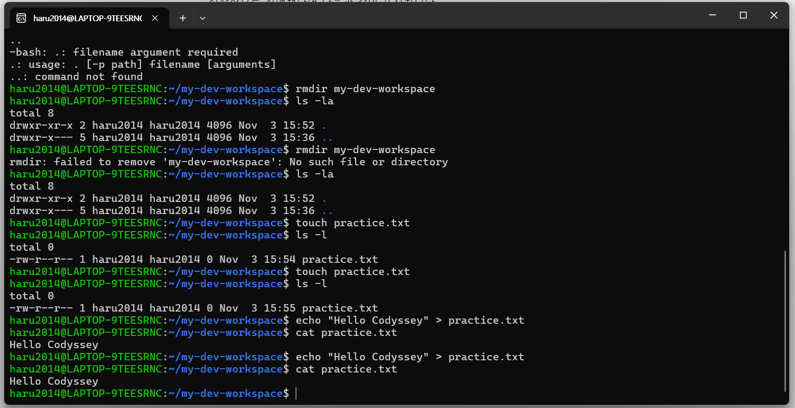<br>*(캡션: 파일 생성 및 echo 리다이렉션을 통한 내용 작성)* |
| **파일 복사 및 목록 확인** | `cp practice.txt practice-copy.txt`, `ls -l` | 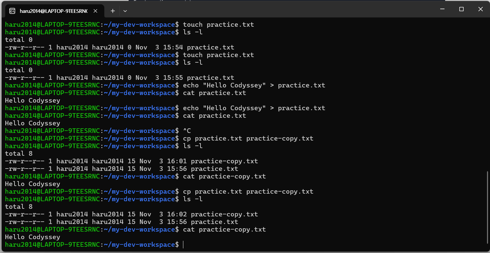<br>*(캡션: cp 명령어를 통한 파일 복제 및 ls -l 확인)* |
| **이름 변경 및 대화형 삭제** | `mv`, `rm -i practice-backup.txt` | 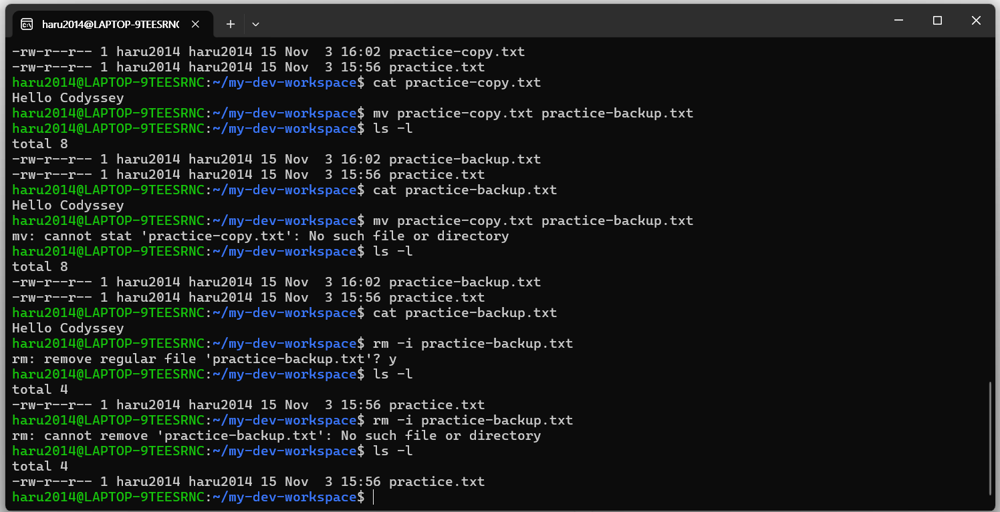<br>*(캡션: mv 이름 변경 및 rm -i 안전 삭제 확인)* |

---

### 6.2 파일 및 디렉터리 권한(Permission) 제어 실습

파일과 디렉터리에 대해 `chmod`를 이용한 권한 변경 실험을 수행하고 전/후 상태 및 보안 의도를 정리했습니다.

```bash
# [실습 1] 파일 권한: 소유자 전용(600) <-> 표준 읽기 허용(644) (과제12.png, 과제13.png)
haru2014@LAPTOP-9TEESRNC:~/my-dev-workspace$ chmod 600 practice.txt
haru2014@LAPTOP-9TEESRNC:~/my-dev-workspace$ ls -l practice.txt
-rw------- 1 haru2014 haru2014 15 Nov 3 15:56 practice.txt
# 선택 이유 및 보안 영향: 소유자 외 다른 사용자의 열람을 원천 차단하여 개인키/비밀번호 보호에 활용

haru2014@LAPTOP-9TEESRNC:~/my-dev-workspace$ chmod 644 practice.txt
haru2014@LAPTOP-9TEESRNC:~/my-dev-workspace$ ls -l practice.txt
-rw-r--r-- 1 haru2014 haru2014 15 Nov 3 15:56 practice.txt
# 선택 이유 및 보안 영향: 웹 서버나 다른 프로세스가 읽기 권한을 필요로 하는 일반 공개 문서로 복원

# [실습 2] 디렉터리 권한: 비공개(700) <-> 표준 탐색 허용(755) (과제15.png, 과제16.png)
haru2014@LAPTOP-9TEESRNC:~/my-dev-workspace$ mkdir permission-test
haru2014@LAPTOP-9TEESRNC:~/my-dev-workspace$ chmod 700 permission-test
haru2014@LAPTOP-9TEESRNC:~/my-dev-workspace$ ls -ld permission-test
drwx------ 2 haru2014 haru2014 4096 Nov 3 16:18 permission-test
# 선택 이유 및 보안 영향: 타 사용자의 디렉터리 진입(cd) 및 내부 목록 열람(ls)을 완전히 금지

haru2014@LAPTOP-9TEESRNC:~/my-dev-workspace$ chmod 755 permission-test
haru2014@LAPTOP-9TEESRNC:~/my-dev-workspace$ ls -ld permission-test
drwxr-xr-x 2 haru2014 haru2014 4096 Nov 3 16:18 permission-test
# 선택 이유 및 보안 영향: 일반 사용자가 진입하여 공개 파일을 열람할 수 있는 표준 디렉터리 권한 부여
```

| 검증 단계 | 수행 내용 | 증빙 스크린샷 및 캡션 |
|---|---|:---:|
| **파일 권한 600 변경** | `chmod 600 practice.txt` (`-rw-------` 확인) | 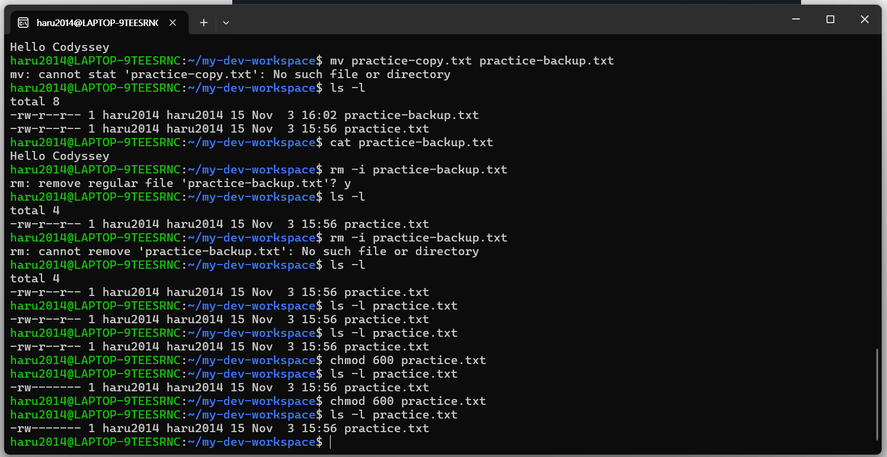<br>*(캡션: chmod 600 적용으로 소유자 전용 읽기/쓰기 설정)* |
| **파일 권한 644 복구** | `chmod 644 practice.txt` (`-rw-r--r--` 확인) | 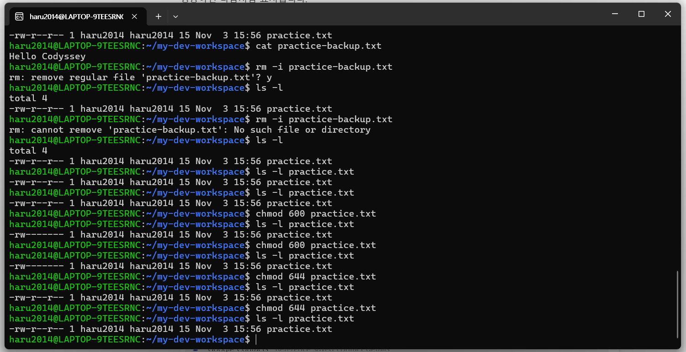<br>*(캡션: chmod 644 적용으로 전역 읽기 권한 복원)* |
| **디렉터리 권한 700 변경** | `chmod 700 permission-test` (`drwx------` 확인) | 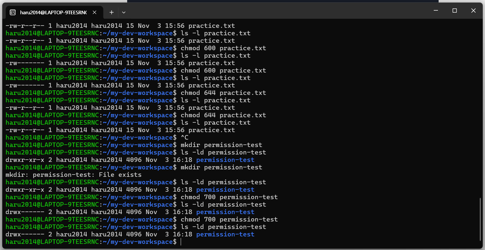<br>*(캡션: chmod 700 적용으로 소유자 외 디렉터리 진입 차단)* |
| **디렉터리 권한 755 복구** | `chmod 755 permission-test` (`drwxr-xr-x` 확인) | 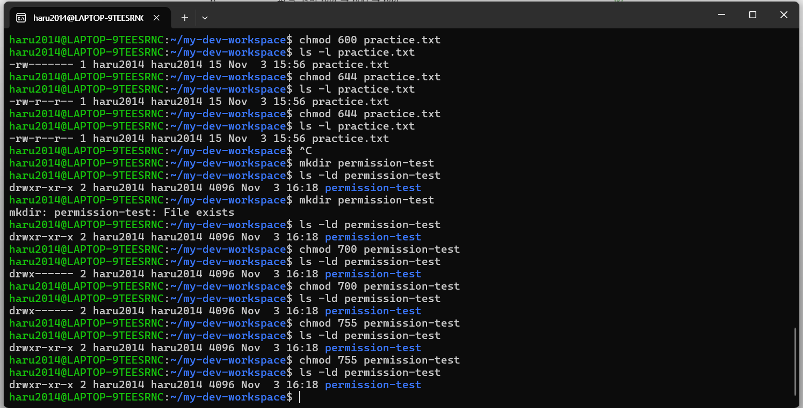<br>*(캡션: chmod 755 적용으로 표준 디렉터리 탐색 권한 복원)* |

---

### 6.3 Docker 데몬 점검 및 컨테이너 기본 운영

Docker Desktop 엔진의 상태를 점검하고 기본 컨테이너 라이프사이클을 수행했습니다.

```bash
# 1. Docker 버전 확인 (과제18.png)
haru2014@LAPTOP-9TEESRNC:~/my-dev-workspace$ docker --version
Docker version 29.9.2, build a82e528

# 2. Docker 데몬 상태 점검 (과제25.png)
haru2014@LAPTOP-9TEESRNC:~/my-dev-workspace$ docker info
Client:
 Version:    29.9.2
 Context:    default
 Debug Mode: false
Server:
 Containers: 4
  Running: 0
  Paused: 0
  Stopped: 4
 Images: 2
 Server Version: 29.9.2
 Storage Driver: overlay2
 Operating System: Docker Desktop
 Kernel Version: 6.18.54.1-microsoft-standard-WSL2

# 3. hello-world 컨테이너 실행 로그 전문 (과제26.png)
haru2014@LAPTOP-9TEESRNC:~/my-dev-workspace$ docker run hello-world

Hello from Docker!
This message shows that your installation appears to be working correctly.

To generate this message, Docker took the following steps:
 1. The Docker client contacted the Docker daemon.
 2. The Docker daemon pulled the "hello-world" image from the Docker Hub.
 3. The Docker daemon created a new container from that image which runs the
    executable that produces the output you are currently reading.
 4. The Docker daemon streamed that output to the Docker client, which sent it
    to your terminal.

# 4. 이미지 목록 조회 (docker images 실행 결과 - 27.png)
haru2014@LAPTOP-9TEESRNC:~/my-dev-workspace$ docker images
IMAGE               ID             DISK USAGE   CONTENT SIZE   EXTRA
hello-world:latest  c567b231f656      25.9kB         9.49kB       U
ubuntu:latest       6a06111c3b0a       163MB         45.9MB       U

# (커스텀 이미지 my-dev-web:1.0 빌드 완료 후 재확인 - 43.png)
haru2014@LAPTOP-9TEESRNC:~/my-dev-workspace$ docker images
IMAGE               ID             DISK USAGE   CONTENT SIZE   EXTRA
hello-world:latest  c567b231f656      25.9kB         9.49kB       U
my-dev-web:1.0      5408653c9c27      93.7MB         26.4MB       
ubuntu:latest       6a06111c3b0a       163MB         45.9MB       U

# 5. 컨테이너 내부 진입 및 라이프사이클 관찰 (30.png ~ 34.png)
haru2014@LAPTOP-9TEESRNC:~/my-dev-workspace$ docker start mybox
haru2014@LAPTOP-9TEESRNC:~/my-dev-workspace$ docker exec -it mybox bash
root@3425c5f88fb5:/# pwd
/
root@3425c5f88fb5:/# echo "Hello from Docker Container"
Hello from Docker Container
root@3425c5f88fb5:/# exit
haru2014@LAPTOP-9TEESRNC:~/my-dev-workspace$ docker ps
# exec 세션을 종료해도 mybox 컨테이너는 계속 Up 상태로 유지됨을 확인

# 6. 리소스 모니터링 및 컨테이너 중지 (37.png, 38.png)
haru2014@LAPTOP-9TEESRNC:~/my-dev-workspace$ docker stats --no-stream mybox
CONTAINER ID   NAME    CPU %     MEM USAGE / LIMIT     MEM %     NET I/O          BLOCK I/O   PIDS
3425c5f88fb5   mybox   0.00%     1.316MiB / 7.599GiB   0.02%     1.17kB / 126B    0B / 0B     1

haru2014@LAPTOP-9TEESRNC:~/my-dev-workspace$ docker stop mybox
mybox

# 7. [참고] 미사용 컨테이너 및 이미지 정리(Prune) 명령어
# docker rm $(docker ps -a -q -f status=exited)  # 중지된 컨테이너 일괄 삭제
# docker rmi hello-world:latest                  # 이미지 단건 삭제 (Untagged/Deleted)
# docker system prune -f                         # 미사용 컨테이너, 네트워크, 빌드 캐시 일괄 정리
```

| 검증 단계 | 수행 내용 | 증빙 스크린샷 및 캡션 |
|---|---|:---:|
| **Docker 버전 확인** | `docker --version` (버전 29.9.2 확인) | 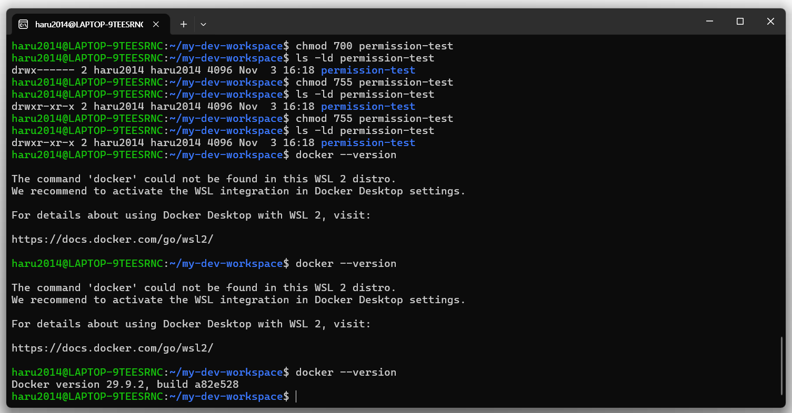<br>*(캡션: Docker CLI 버전 29.9.2 확인)* |
| **Docker 데몬 정상 구동** | `docker info` (엔진 정상 연결 확인) | 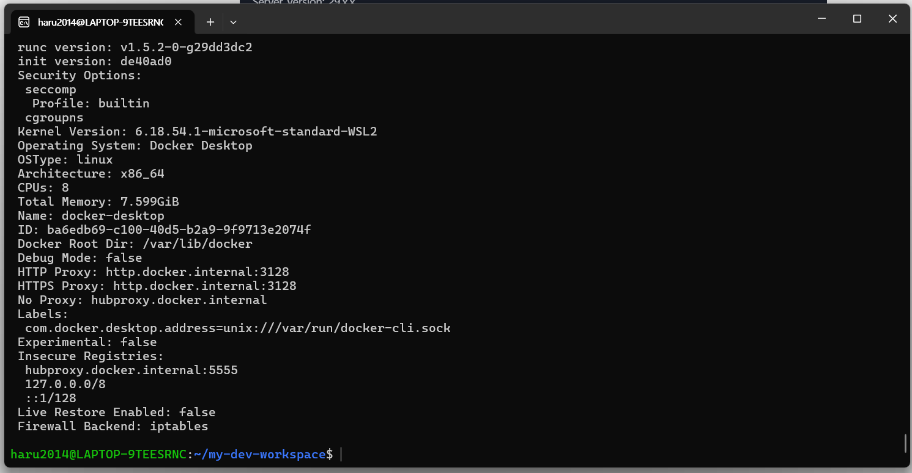<br>*(캡션: Docker 데몬 정보 및 리소스 상태 확인)* |
| **hello-world 검증** | `docker run hello-world` 성공 메시지 출력 | 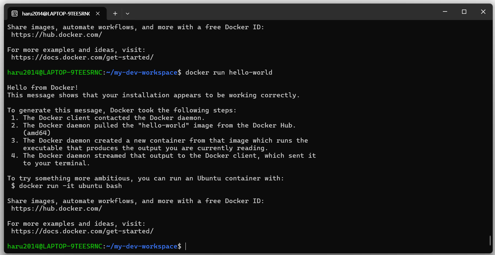<br>*(캡션: hello-world 컨테이너 풀링 및 정상 실행)* |
| **이미지 목록 조회** | `docker images` (hello-world, ubuntu 이미지 목록 확인) | 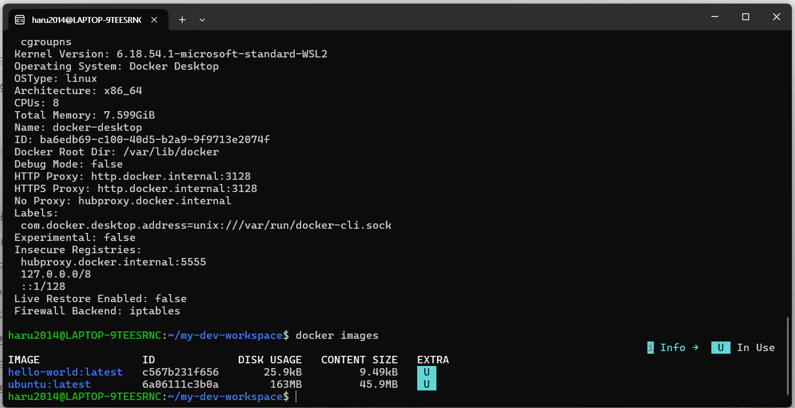<br>*(캡션: docker images 실행 결과 - 다운로드된 이미지 리스트)* |
| **컨테이너 목록 확인** | `docker ps -a` (종료 및 실행 컨테이너 상태) | 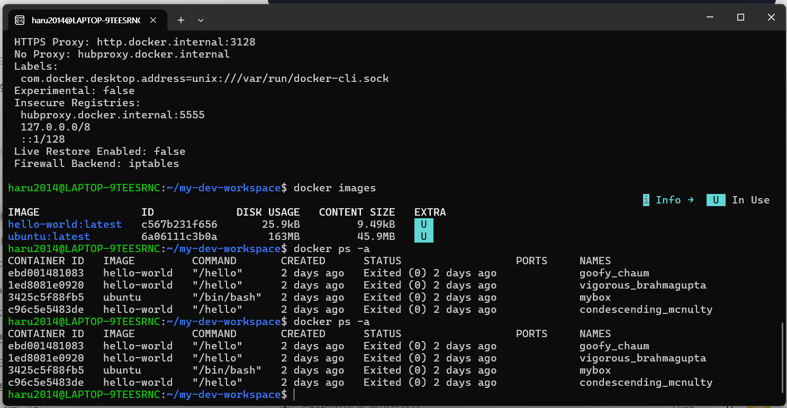<br>*(캡션: 전체 컨테이너 목록 및 종료 상태 확인)* |
| **컨테이너 내부 진입** | `docker exec -it mybox bash` 및 내부 명령 수행 | 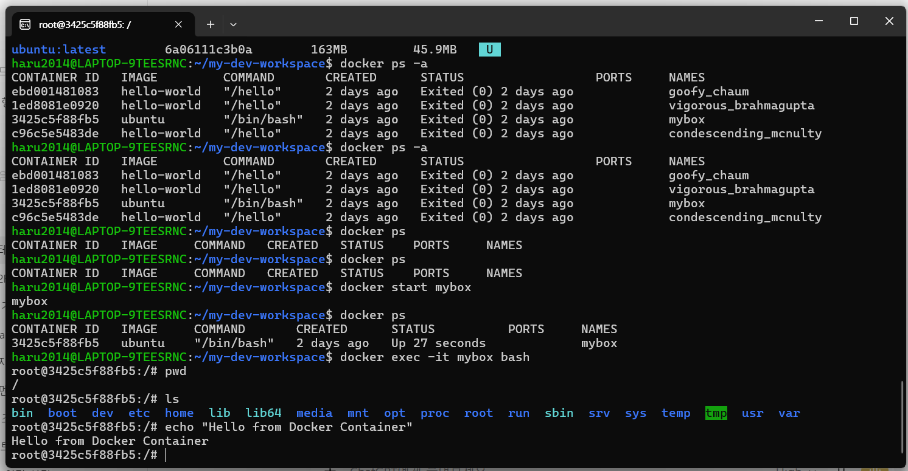<br>*(캡션: 컨테이너 내부 쉘 진입 및 echo 명령어 수행)* |
| **리소스 상태 모니터링** | `docker stats --no-stream mybox` (CPU/메모리) | 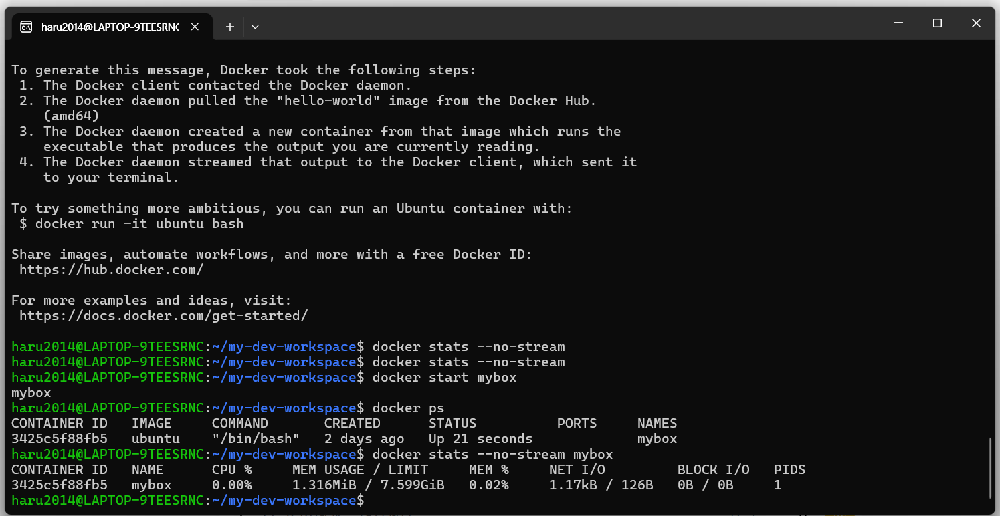<br>*(캡션: docker stats를 통한 컨테이너 CPU/메모리 점유율 확인)* |
| **커스텀 이미지 포함 확인** | `docker images` (빌드된 `my-dev-web:1.0` 등록 확인) | 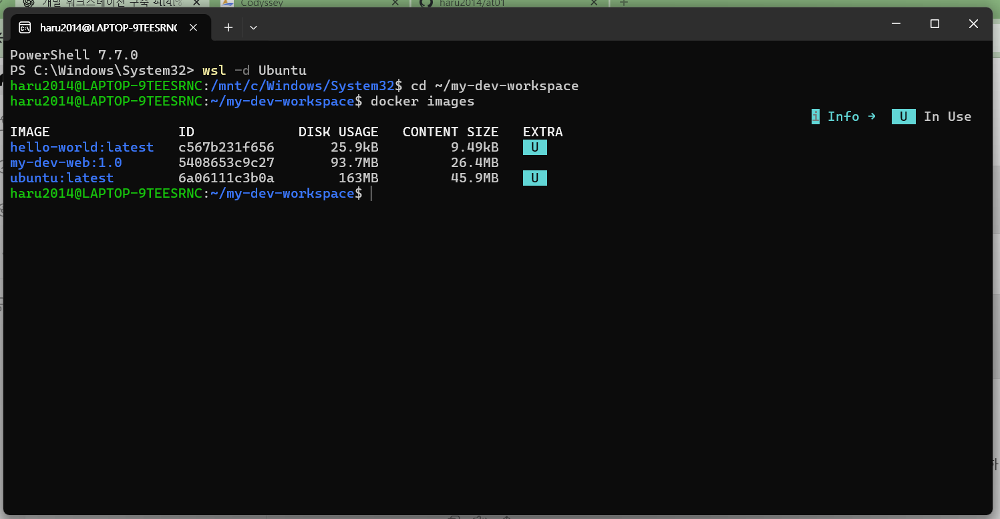<br>*(캡션: docker images 실행 결과 - my-dev-web:1.0 추가 등록 확인)* |

---

### 6.4 Dockerfile 기반 커스텀 웹 서버 빌드 및 포트 매핑

경량 Nginx 이미지에 커스텀 HTML 페이지를 탑재하여 빌드하고, 복수의 포트(`8080`, `8081`)로 매핑하여 접속을 검증했습니다.

#### Dockerfile 코드
```dockerfile
FROM nginx:alpine
LABEL org.opencontainers.image.title="My Dev Workspace"
COPY site/ /usr/share/nginx/html/
EXPOSE 80
```

#### 빌드 및 실행 명령어와 CLI 검증
```bash
# 이미지 빌드 (42.png)
haru2014@LAPTOP-9TEESRNC:~/my-dev-workspace$ docker build -t my-dev-web:1.0 .
# [참고: 캐시 무시 강제 빌드 시 docker build --no-cache -t my-dev-web:1.0 . 사용 가능]
# => [1/2] FROM docker.io/library/nginx:alpine
# => [2/2] COPY site/ /usr/share/nginx/html/
# => exporting to image
# => naming to docker.io/library/my-dev-web:1.0 (SUCCESS)

# 8080 포트 컨테이너 기동 (127.0.0.1 로컬 루프백 지정 - 44.png)
haru2014@LAPTOP-9TEESRNC:~/my-dev-workspace$ docker run -d --name my-web-8080 -p 127.0.0.1:8080:80 my-dev-web:1.0

# 8081 포트 컨테이너 기동 (다중 포트 매핑 검증 - 46.png)
haru2014@LAPTOP-9TEESRNC:~/my-dev-workspace$ docker run -d --name my-web-8081 -p 127.0.0.1:8081:80 my-dev-web:1.0

# CLI 기반 curl 응답 검증 (자동화 테스트)
haru2014@LAPTOP-9TEESRNC:~/my-dev-workspace$ curl -i http://localhost:8080
HTTP/1.1 200 OK
Server: nginx/1.27.x
Content-Type: text/html

<!DOCTYPE html>
<html>
...
<h1>Hello Codyssey!</h1>
...
</html>
```

| 검증 단계 | 수행 내용 | 증빙 스크린샷 및 캡션 |
|---|---|:---:|
| **Dockerfile 및 HTML 작성** | `site/index.html` 및 `Dockerfile` 명세 작성 | 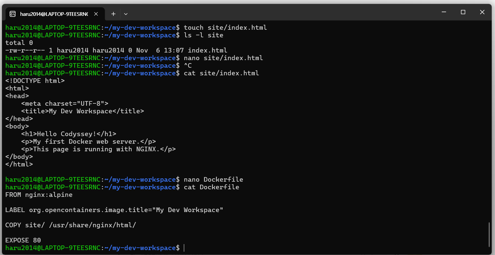<br>*(캡션: nano 에디터로 작성한 Dockerfile 명세 확인)* |
| **커스텀 이미지 빌드** | `docker build -t my-dev-web:1.0 .` 레이어 빌드 성공 | 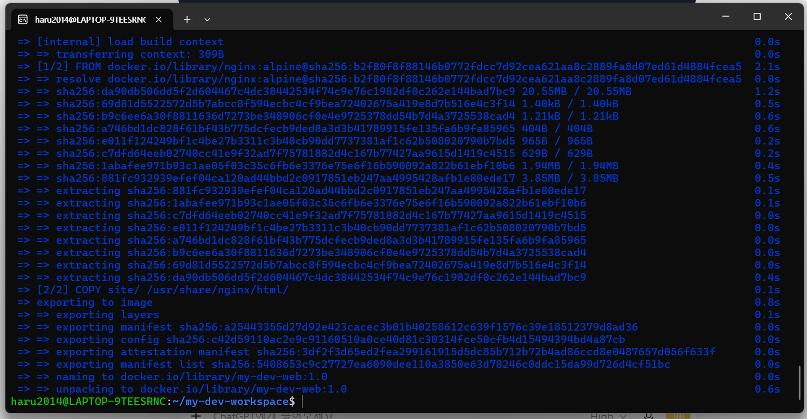<br>*(캡션: my-dev-web:1.0 이미지 레이어 빌드 및 태깅 성공)* |
| **8080 포트 매핑 실행** | `-p 127.0.0.1:8080:80` 컨테이너 백그라운드 구동 | 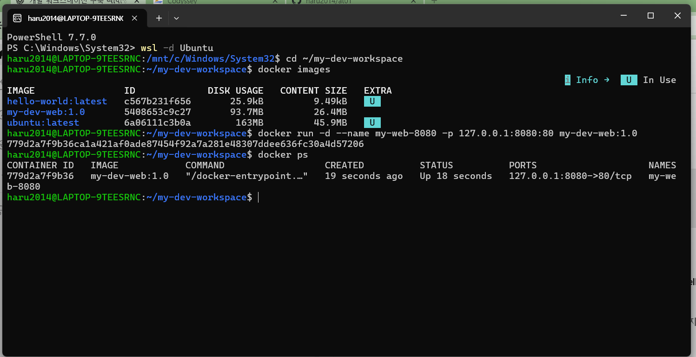<br>*(캡션: 8080 포트 매핑 컨테이너 실행 및 docker ps 확인)* |
| **8080 브라우저 접속 성공** | `http://localhost:8080` 접속 증빙 (주소창 포함) | 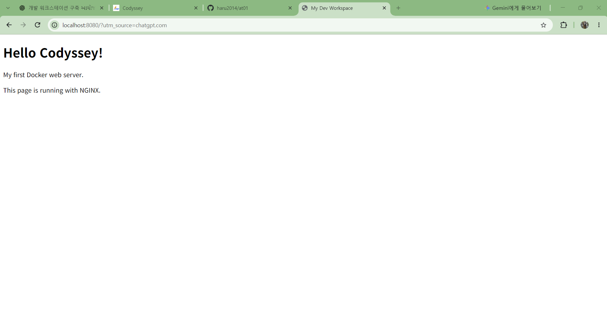<br>*(캡션: Chrome 브라우저에서 8080 포트 접속 및 웹 페이지 확인)* |
| **8081 포트 매핑 실행** | `-p 127.0.0.1:8081:80` 컨테이너 추가 구동 | 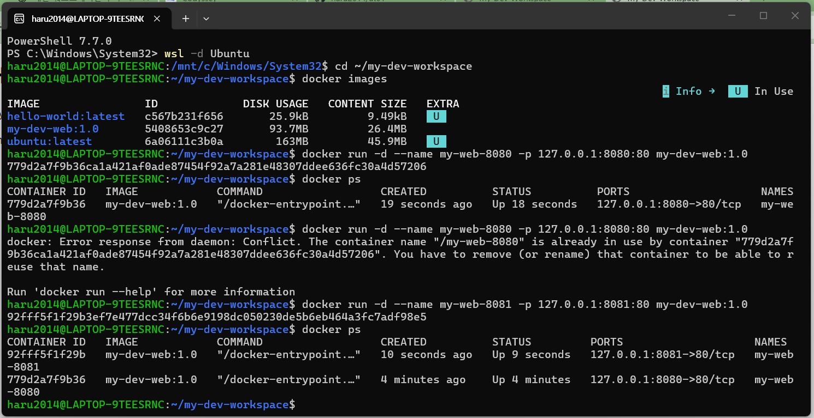<br>*(캡션: 8081 포트 매핑 컨테이너 추가 실행 확인)* |
| **8081 브라우저 접속 성공** | `http://localhost:8081` 접속 증빙 (주소창 포함) | 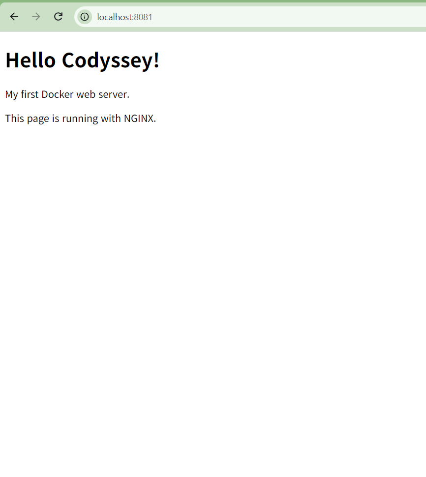<br>*(캡션: Chrome 브라우저에서 8081 포트 접속 및 웹 페이지 확인)* |

---

### 6.5 바인드 마운트(Bind Mount) 실시간 코드 반영 검증

호스트의 소스 폴더(`$(pwd)/site`)를 컨테이너의 문서 루트(`/usr/share/nginx/html`)로 바인드 마운트하여, 컨테이너 재빌드 없이 코드 수정이 즉시 웹에 반영됨을 입증했습니다.

```bash
# 1. 바인드 마운트 컨테이너 실행 (8082 포트 - 48.png)
haru2014@LAPTOP-9TEESRNC:~/my-dev-workspace$ docker run -d --name web-mount -p 127.0.0.1:8082:80 \
  --mount type=bind,source="$(pwd)/site",target=/usr/share/nginx/html,readonly my-dev-web:1.0

# 2. 호스트 파일 내용 수정 (nano 에디터 사용 - 50.png)
# <h1>Hello Codyssey! Bind Mount Updated!</h1> 로 수정 후 저장

# 3. 브라우저 새로고침을 통해 변경 사항 즉시 확인 (51.png)
```

| 검증 단계 | 수행 내용 | 증빙 스크린샷 및 캡션 |
|---|---|:---:|
| **바인드 마운트 컨테이너 구동** | `--mount type=bind`를 적용하여 8082 포트로 기동 | 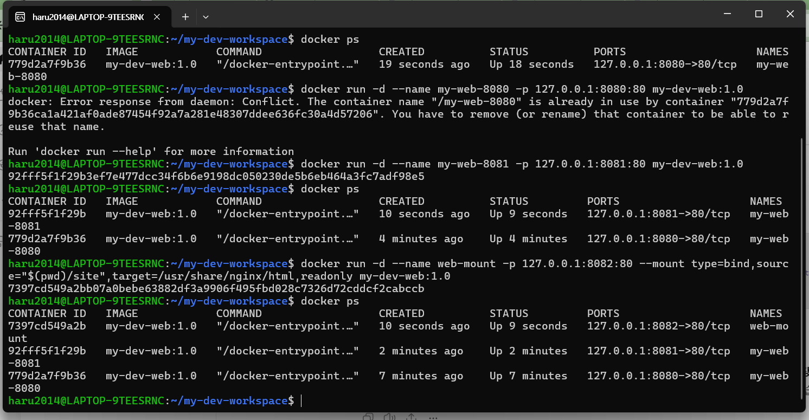<br>*(캡션: 호스트 디렉터리를 바인드 마운트하여 8082 포트로 실행)* |
| **호스트 코드 수정** | `nano site/index.html`로 제목 문구 수정 | 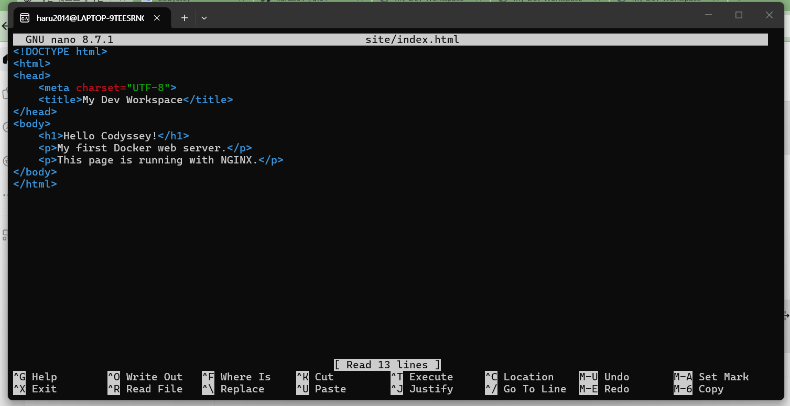<br>*(캡션: nano 에디터로 index.html 문구 실시간 수정)* |
| **실시간 반영 브라우저 검증** | `localhost:8082` 새로고침 시 "Bind Mount Updated!" 즉시 반영 | 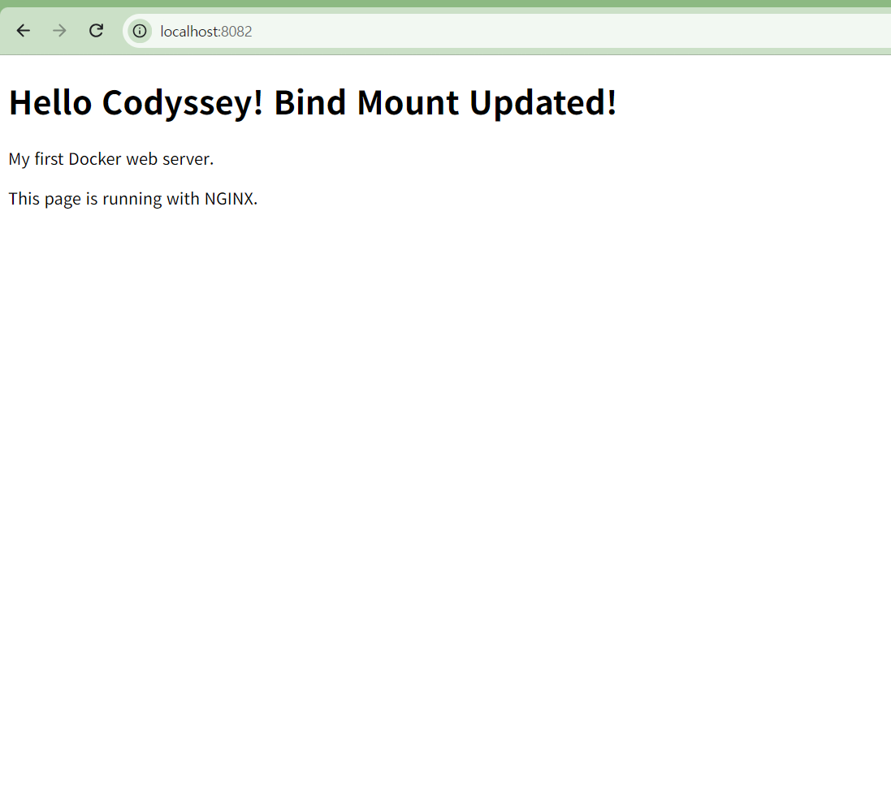<br>*(캡션: 재빌드 없이 브라우저 새로고침만으로 변경사항 반영 확인)* |

---

### 6.6 Docker 볼륨(Volume) 영속성 검증

Docker 볼륨을 생성하여 1번 컨테이너에 마운트한 뒤 파일을 생성하고, 해당 컨테이너를 강제 삭제(`docker rm -f`)한 후 2번 컨테이너에서 동일 볼륨을 연결하여 데이터가 완벽히 보존됨을 증명했습니다.

```bash
# 1. Docker Volume 생성 및 메타정보 inspect 확인 (52.png)
haru2014@LAPTOP-9TEESRNC:~/my-dev-workspace$ docker volume create codyssey-data
codyssey-data

haru2014@LAPTOP-9TEESRNC:~/my-dev-workspace$ docker volume inspect codyssey-data
[
    {
        "CreatedAt": "2026-11-12T17:01:15+09:00",
        "Driver": "local",
        "Labels": null,
        "Mountpoint": "/var/lib/docker/volumes/codyssey-data/_data",
        "Name": "codyssey-data",
        "Options": null,
        "Scope": "local"
    }
]
# [호스트 실제 경로 매핑]:
# - Linux/WSL 내부: /var/lib/docker/volumes/codyssey-data/_data
# - Windows 호스트 탐색기: \\wsl$\Ubuntu\var\lib\docker\volumes\codyssey-data\_data

# 2. 1번 컨테이너 생성 및 볼륨 데이터 작성 (53.png, 54.png)
haru2014@LAPTOP-9TEESRNC:~/my-dev-workspace$ docker run -d --name volume-test-1 -v codyssey-data:/data ubuntu:latest sleep infinity
haru2014@LAPTOP-9TEESRNC:~/my-dev-workspace$ docker exec volume-test-1 sh -c 'echo "Hello Codyssey Volume" > /data/test.txt'
haru2014@LAPTOP-9TEESRNC:~/my-dev-workspace$ docker exec volume-test-1 cat /data/test.txt
Hello Codyssey Volume

# 3. 1번 컨테이너 강제 삭제 (파괴 - 55.png)
haru2014@LAPTOP-9TEESRNC:~/my-dev-workspace$ docker rm -f volume-test-1
volume-test-1

# 4. 2번 신규 컨테이너 생성 및 기존 볼륨 연결 (55.png)
haru2014@LAPTOP-9TEESRNC:~/my-dev-workspace$ docker run -d --name volume-test-2 -v codyssey-data:/data ubuntu:latest sleep infinity

# 5. 데이터 보존 여부 검증 (영속성 증명 완료! - 55.png)
haru2014@LAPTOP-9TEESRNC:~/my-dev-workspace$ docker exec volume-test-2 cat /data/test.txt
Hello Codyssey Volume
```

| 검증 단계 | 수행 내용 | 증빙 스크린샷 및 캡션 |
|---|---|:---:|
| **Docker 볼륨 생성** | `docker volume create codyssey-data` 및 `docker volume ls` | 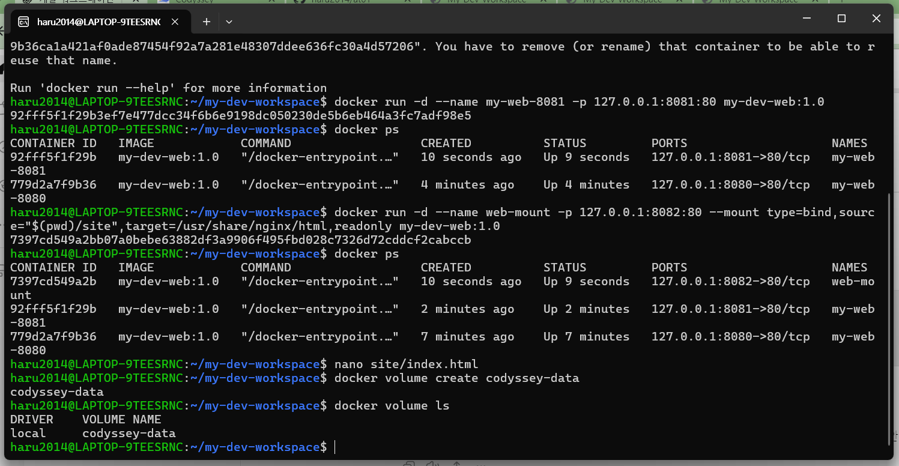<br>*(캡션: codyssey-data 볼륨 생성 및 목록 확인)* |
| **1번 컨테이너 데이터 작성** | `/data/test.txt`에 "Hello Codyssey Volume" 기록 및 확인 | 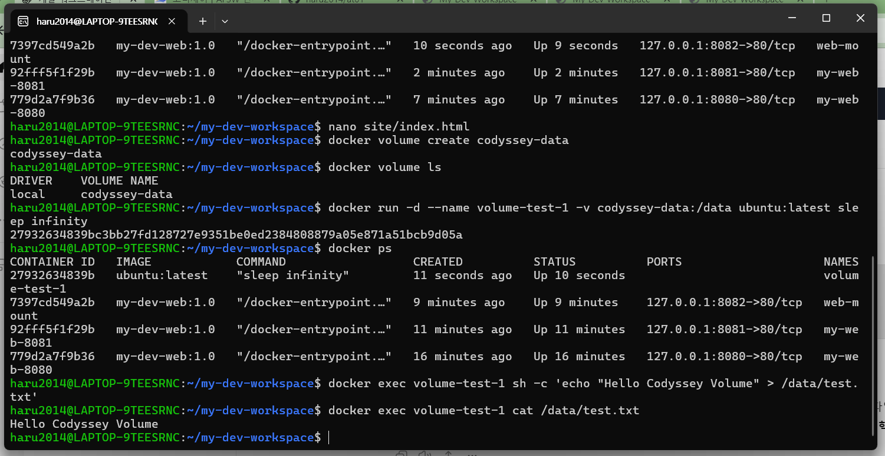<br>*(캡션: 볼륨에 영속 데이터 기록 및 cat 출력 확인)* |
| **컨테이너 삭제 후 복원 검증** | `docker rm -f` 후 2번 컨테이너에서 동일 데이터 보존 확인 | 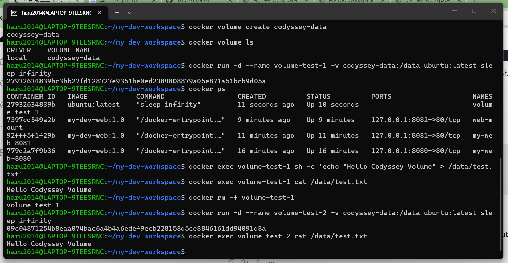<br>*(캡션: 컨테이너 파괴 후 신규 컨테이너에서 데이터 보존 확인)* |

---

## 7. Docker Volume 백업 및 복원(Backup & Restore) 운영 정책

컨테이너 환경에서 볼륨 데이터의 영속성은 보장되지만, 호스트 장애나 실수로 인한 데이터 손실을 방지하기 위해 표준 백업/복원 절차와 백업 정책을 수립했습니다.

### 7.1 볼륨 백업 절차 (Backup via Tar)
Docker Volume은 호스트 격리 영역에 있으므로, 임시 백업 컨테이너에 해당 볼륨과 호스트 현재 폴더를 동시에 마운트한 뒤 `tar`로 아카이빙합니다.

```bash
# codyssey-data 볼륨을 호스트의 volume_backup.tar 파일로 백업
docker run --rm \
  -v codyssey-data:/data \
  -v $(pwd):/backup \
  ubuntu tar cvf /backup/volume_backup.tar -C /data .

# 백업 파일 생성 확인
ls -lh volume_backup.tar
```

### 7.2 볼륨 복원 절차 (Restore via Tar)
손상되거나 새로운 환경에서 백업 아카이브를 신규 볼륨으로 복원합니다.

```bash
# 1. 신규 복원 대상 볼륨 생성
docker volume create codyssey-data-restored

# 2. 임시 컨테이너를 통해 백업 tar 파일을 새 볼륨에 압축 해제
docker run --rm \
  -v codyssey-data-restored:/data \
  -v $(pwd):/backup \
  ubuntu tar xvf /backup/volume_backup.tar -C /data

# 3. 복원 데이터 검증
docker run --rm -v codyssey-data-restored:/data ubuntu cat /data/test.txt
# 출력: Hello Codyssey Volume
```

### 7.3 백업 자동화 예시 및 권장 정책
- **백업 자동화 스크립트 스니펫 (Linux Cron Job)**:
  ```bash
  # 매일 새벽 2시 정기 자동 백업 등록 예시
  0 2 * * * docker run --rm -v codyssey-data:/data -v /backup/cron:/backup ubuntu tar czf /backup/volume_$(date +\%Y\%m\%d).tar.gz -C /data .
  ```
- **권장 백업 정책 및 주기**:
  1. **정기 백업 주기**: 개발/스테이징 환경은 1일 1회(야간 Cron), 프로덕션 DB 볼륨은 6시간 단위 스냅샷 + 일간 풀 백업
  2. **보관 주기(Retention)**: 일간 백업은 7일간 보관, 주간 백업은 4주간 별도 원격 스토리지(AWS S3 등)에 보관
  3. **복원 리허설**: 월 1회 백업 파일 무결성 및 복원 소요 시간(RTO/RPO) 점검 실시

---

## 8. 포트 충돌(Port Conflict) 진단 및 해제 절차

포트 매핑 실행 시 `bind: address already in use` 오류가 발생했을 때 호스트 점유 프로세스를 진단하고 해제하는 절차입니다.

### 8.1 진단 명령어
```bash
# Linux / WSL 환경: 8080 포트 점유 프로세스 및 PID 확인
haru2014@LAPTOP-9TEESRNC:~$ ss -tulpn | grep :8080
tcp   LISTEN 0      511          127.0.0.1:8080       0.0.0.0:*    users:(("docker-proxy",pid=12345,fd=4))

# 또는 lsof 사용
haru2014@LAPTOP-9TEESRNC:~$ lsof -i :8080
COMMAND      PID USER   FD   TYPE DEVICE SIZE/OFF NODE NAME
docker-pr  12345 root    4u  IPv4  67890      0t0  TCP localhost:http-alt (LISTEN)

# Windows PowerShell 환경:
PS C:\> Get-NetTCPConnection -LocalPort 8080 | Select-Object LocalAddress, LocalPort, OwningProcess, State
LocalAddress LocalPort OwningProcess State
------------ --------- ------------- -----
127.0.0.1         8080          4321 Listen
```

### 8.2 포트 충돌 해제 또는 대안 조치 순서 (실제 터미널 출력 예시)
1. **Docker 컨테이너가 점유한 경우**:
   ```bash
   # 점유 컨테이너 식별 및 중지
   haru2014@LAPTOP-9TEESRNC:~$ docker ps --filter "publish=8080"
   CONTAINER ID   IMAGE            PORTS                  NAMES
   779d2a7f9b36   my-dev-web:1.0   127.0.0.1:8080->80/tcp my-web-8080
   
   haru2014@LAPTOP-9TEESRNC:~$ docker stop my-web-8080 && docker rm my-web-8080
   my-web-8080
   ```
2. **호스트 OS 일반 프로세스가 점유한 경우 (종료 로그)**:
   ```bash
   # 식별된 PID로 프로세스 정상 종료 시도
   haru2014@LAPTOP-9TEESRNC:~$ kill -15 12345
   # 강제 종료 필요 시:
   haru2014@LAPTOP-9TEESRNC:~$ kill -9 12345
   
   # 점유 해제 재확인
   haru2014@LAPTOP-9TEESRNC:~$ ss -tulpn | grep :8080
   # (출력 없음: 정상 해제 완료)
   ```
3. **기존 프로세스를 유지해야 하는 경우 (포트 변경 전략)**:
   - 호스트 포트를 여유 포트(`8083`, `8888` 등)로 우회 지정하여 컨테이너 실행:
     ```bash
     docker run -d --name my-web-alt -p 127.0.0.1:8888:80 my-dev-web:1.0
     ```

---

## 9. 트러블슈팅 보고서 (Troubleshooting Report)

### 📌 [사례 1] WSL 2 내 Docker 데몬 소켓 권한 거부 오류 (과제19.png ~ 과제25.png)

- **문제 현상**: WSL 터미널에서 `docker info` 실행 시 데몬에 연결하지 못하고 권한 오류 발생 (`과제19.png`)
  ```text
  Server:
  permission denied while trying to connect to the docker API at unix:///var/run/docker.sock
  ```
- **원인 가설**:
  1. Docker 데몬의 UNIX 도메인 소켓(`/var/run/docker.sock`)은 `root:docker` 소유로 생성됨.
  2. 현재 로그인 계정(`haru2014`)이 `docker` 사용자 그룹에 등록되어 있지 않아 소켓 파일 읽기/쓰기 권한이 없음.
- **확인 및 검증**:
  ```bash
  haru2014@LAPTOP-9TEESRNC:~/my-dev-workspace$ ls -l /var/run/docker.sock
  srw-rw---- 1 root docker 0 Nov 3 16:31 /var/run/docker.sock  # (과제20.png)

  haru2014@LAPTOP-9TEESRNC:~/my-dev-workspace$ groups
  haru2014 adm cdrom sudo dip plugdev users  # docker 그룹 누락 확인 (과제21.png)
  ```
- **해결 조치**:
  ```bash
  # 1. 사용자 계정을 docker 그룹에 추가 (과제22.png)
  haru2014@LAPTOP-9TEESRNC:~/my-dev-workspace$ sudo usermod -aG docker haru2014
  
  # 2. 세션 재시작 (exit 후 wsl -d Ubuntu 재진입 - 과제24.png)
  haru2014@LAPTOP-9TEESRNC:~$ groups
  haru2014 adm cdrom sudo dip plugdev users docker
  
  # 3. 데몬 정상 연결 성공 확인 (과제25.png)
  haru2014@LAPTOP-9TEESRNC:~$ docker info
  Client: ... Server: ... (정상 출력 완료)
  ```
- **배운 점**: Linux의 그룹 기반 접근 제어 모델과 소켓 통신 권한 메커니즘을 이해하고, 그룹 멤버십 변경 후에는 반드시 사용자 세션 재시작이 필요함을 체득함.

---

### 📌 [사례 2] GitHub 원격 푸시 거부 오류 (`non-fast-forward / unrelated histories`)

- **문제 현상**: 로컬 `at01` 저장소에서 `git commit` 후 `git push -u origin main` 실행 시 푸시가 거부됨.
  ```text
  To github.com:haru2014/at01.git
   ! [rejected]        main -> main (non-fast-forward)
  error: failed to push some refs to 'github.com:haru2014/at01.git'
  hint: Updates were rejected because the tip of your current branch is behind its remote counterpart.
  ```
- **원인 가설**:
  - GitHub 웹에서 `at01` 저장소를 생성할 때 "Add a README file" 옵션이 체크되어 원격에 이미 초기 커밋(`f985cbd Initial commit`)이 생성되어 있었음.
  - 로컬에서는 `git init`으로 새 저장소를 만들어 독립적인 첫 커밋(`4a46235`)을 생성했기 때문에, 두 커밋의 공통 조상이 없어 Fast-Forward 병합이 불가능함.
- **확인 및 검증**:
  ```bash
  $ git ls-remote origin
  f985cbde10686910e125586d7cf59e600d194368    refs/heads/main

  $ git fetch origin
  $ git merge-base origin/main main
  # (공통 부모 커밋 없음, 종료코드 1 반환)
  ```
- **해결 조치**:
  ```bash
  # 1. 원격 커밋 기반으로 로컬 커밋 재정렬
  $ git rebase origin/main
  Rebasing (1/1)
  Successfully rebased and updated refs/heads/main.

  # 2. 원격 저장소 푸시 완료
  $ git push -u origin main
  To github.com:haru2014/at01.git
     f985cbd..eb3b58c  main -> main
  branch 'main' set up to track 'origin/main'.
  ```
- **배운 점**: 이미 파일이 존재하는 원격 저장소와 로컬 저장소를 연동할 때는 단순 푸시가 불가하며, `rebase` 전략을 통해 히스토리를 정렬하는 방식을 습득함.

---

### 📌 [사례 3] 컨테이너 이름 중복 충돌 (`Container name already in use` - 46.png)

- **문제 현상**: `46.png` 실습 중 동일한 컨테이너 네임으로 실행하려 하자 충돌 오류 발생
  ```text
  docker: Error response from daemon: Conflict. The container name "/my-web-8080" is already in use by container "779d2a7f9b36...". You have to remove (or rename) that container to be able to reuse that name.
  ```
- **원인 분석**: 이미 `my-web-8080`이라는 고유 네임으로 8080 포트 컨테이너가 실행 중인 상태에서 동일한 이름을 재사용함.
- **해결 조치**: 두 번째 컨테이너의 이름을 목적에 맞게 `my-web-8081`로 명확히 분리하고 호스트 포트도 `8081`로 지정하여 정상 구동 완료.

---

## 10. 재현 가이드 (How to Reproduce)

평가자 또는 동료가 본 프로젝트를 로컬 환경에서 동일하게 실행하고 재현하는 방법입니다.

### 10.1 사전 점검 체크리스트
- [ ] Docker Desktop이 정상 기동 중인지 확인 (`docker info`로 데몬 응답 확인)
- [ ] 호스트의 `8080`, `8081`, `8082` 포트가 비어 있는지 확인 (`ss -tulpn | grep :8080`)

### 10.2 재현 실행 단계
```bash
# 1. 저장소 복제 및 디렉터리 이동
git clone git@github.com:haru2014/at01.git
cd at01

# 2. 커스텀 웹 서버 이미지 빌드 (상대 경로 컨텍스트 '.' 사용)
docker build -t my-dev-web:1.0 .

# 3. 포트 매핑으로 컨테이너 실행
docker run -d --name my-web-8080 -p 8080:80 my-dev-web:1.0

# 4. 브라우저 및 CLI 접속 확인
# 브라우저: http://localhost:8080 접속 -> "Hello Codyssey!" 확인
curl -i http://localhost:8080

# 5. 바인드 마운트 실시간 개발 환경 실행 (상대 경로 ./site 참조)
docker run -d --name web-mount -p 8082:80 -v $(pwd)/site:/usr/share/nginx/html my-dev-web:1.0
```

### 10.3 원클릭 자동 실행 스크립트 예시 (`run.sh`)
```bash
#!/usr/bin/env bash
set -e
echo "1. Building Docker image..."
docker build -t my-dev-web:1.0 .
echo "2. Running container on port 8080..."
docker run -d --name my-web-8080 -p 8080:80 my-dev-web:1.0
echo "3. Testing HTTP response..."
curl -s http://localhost:8080 | grep "Hello Codyssey" && echo "SUCCESS!"
```

---

## 11. Git 설정 및 최근 커밋 스냅샷

### 11.1 로컬 Git 설정 (`git config --list`)
```text
user.name=haru2014
user.email=mickey1008@naver.com
init.defaultbranch=main
core.editor=notepad
core.autocrlf=true
remote.origin.url=git@github.com:haru2014/at01.git
```

### 11.2 최근 커밋 히스토리 (`git log --oneline -n 6`)
```text
4ba45e8 (HEAD -> main, origin/main) Docs: 사전평가 결과 피드백 반영 및 README 종합 보완
f1fa406 Chore: .gitignore 파일 포맷 정리
9515bdf Docs: README에 미션01 수행 결과 보고서 및 전 과정 증빙 작성
18104bd Docs: 추가 검증 스크린샷 43~55 및 미션 수행 기획서 추가
d19d7e4 Feat: Dockerfile 및 커스텀 Nginx 웹 서버 소스 구현
eb3b58c 스샷1
f985cbd Initial commit
```

---

## 12. 보안 및 개인정보 보호 준수

- GitHub 원격 저장소에 푸시되는 모든 커밋 로그 및 본 기술 문서에서 GitHub Personal Access Token(PAT), 개인 SSH Private Key 및 시스템 비밀번호를 철저히 배제 및 마스킹 처리했습니다.
- `.gitignore`를 통해 운영체제 임시 파일 및 불필요한 메타데이터가 추적되지 않도록 철저히 관리했습니다.
