# Dev-Workstation - 내 컴퓨터에 개발자용 '작업실' 꾸미기

본 프로젝트는 리눅스 CLI(터미널), Git/GitHub(버전 관리 및 협업), Docker(컨테이너 가상화)를 손수 세팅하여 "내 컴퓨터에서만 돌아가는 코드"의 문제를 해결하고, 팀원 누구나 재현 가능한(Reproducible) 개발 워크스테이션 환경을 구축한 결과 보고서입니다.

---

## 1. 프로젝트 개요

- **프로젝트명**: Dev-Workstation (개발자용 작업실 환경 구축)
- **과제 분야**: 코디세이 입학연수 / 개발 입문 미션 01
- **수행 목적**: 
  1. 리눅스 CLI 기반의 디렉터리 탐색, 파일 CRUD 및 권한(Permission) 체계 이해
  2. Docker 가상화 기술을 이용한 격리된 실행 환경 구성 및 컨테이너 라이프사이클 관리
  3. `Dockerfile` 기반 커스텀 웹 서버 제작, 포트 매핑, 바인드 마운트 및 볼륨 영속성 실증
  4. Git과 GitHub를 활용한 버전 관리, 브랜치/원격 연동 및 트러블슈팅 역량 배양
- **제출 저장소**: https://github.com/haru2014/at01

---

## 2. 실행 환경

| 항목 | 구성 사양 | 비고 |
|---|---|---|
| **Host OS** | Windows 11 Home / Pro | 로컬 호스트 환경 |
| **Guest OS (WSL)** | WSL 2 (Ubuntu Linux) | 커널 6.18.54.1-microsoft-standard |
| **Shell & Terminal** | Bash / PowerShell 7.7.0 | Windows Terminal |
| **Docker Engine** | Docker Desktop 29.9.2 (build a82e528) | WSL 2 Engine Backend |
| **Git & IDE** | Git 2.56.0 / Antigravity IDE & VS Code | SSH 키 기반 인증 연동 |

---

## 3. 수행 항목 체크리스트

- [x] **터미널 기본 조작**: 현재 위치 확인, 목록 확인(숨김 파일 포함), 생성, 복사, 이동, 삭제 (`과제01`~`과제10`)
- [x] **권한 실습**: 파일(`600` ↔ `644`) 및 디렉터리(`700` ↔ `755`) 권한 변경 실험 및 전/후 비교 (`과제11`~`과제16`)
- [x] **Docker 설치 및 점검**: `docker --version`, `docker info` 및 데몬 상태 점검 (`과제17`~`과제25`)
- [x] **기본 컨테이너 라이프사이클**: `hello-world`, `ubuntu` 인터랙티브 진입, `logs`, `stats` 모니터링 (`과제26`~`37`)
- [x] **Dockerfile 커스텀 이미지 제작**: `nginx:alpine` 기반 커스텀 인덱스 페이지 탑재 및 빌드 (`38`~`43`)
- [x] **포트 매핑 접속 검증**: 다중 포트(`8080`, `8081`) 컨테이너 구동 및 브라우저 접속 증빙 (`44`~`47`)
- [x] **바인드 마운트 실시간 반영**: 호스트 파일 수정 시 무중단 즉시 반영 검증 (`48`~`51`)
- [x] **볼륨 데이터 영속성 검증**: Docker 볼륨 생성, 컨테이너 삭제 후 신규 컨테이너에서 데이터 유지 증명 (`52`~`55`)
- [x] **트러블슈팅 분석 (2건 이상)**: Docker 소켓 권한 오류 + Git non-fast-forward 푸시 거부 분석 및 해결
- [x] **보안 수칙 준수**: 개인정보, 토큰, 비밀번호 마스킹 및 민감 정보 격리

---

## 4. 핵심 기술 개념 Q&A

### Q1. 절대 경로와 상대 경로의 차이는 무엇인가요?
- **절대 경로 (Absolute Path)**: 최상위 루트 디렉터리(`/` 또는 `C:\`)를 기점으로 파일이나 디렉터리의 고유한 전체 위치를 표현하는 방식입니다. (예: `/home/haru2014/my-dev-workspace/site/index.html`) 현재 작업 디렉터리가 어디든 항상 동일한 대상을 가리킵니다.
- **상대 경로 (Relative Path)**: 현재 위치한 작업 디렉터리(`.` 또는 `pwd`)를 기준으로 대상을 상대적으로 표현하는 방식입니다. (예: `./site/index.html`, `../practice.txt`) 현재 위치에 따라 가리키는 대상이 달라집니다.

### Q2. 파일 권한의 의미(r/w/x)와 755, 644 표기는 어떤 규칙으로 해석되나요?
- 권한은 읽기(`r`=4), 쓰기(`w`=2), 실행(`x`=1)의 3비트 8진수 합산으로 구성되며, **소유자(User) / 소유그룹(Group) / 기타사용자(Others)**의 3단계로 지정됩니다.
- **`755` (`rwxr-xr-x`)**:
  - 소유자: 4 + 2 + 1 = 7 (`rwx`, 읽기/쓰기/실행 전체 허용)
  - 그룹: 4 + 0 + 1 = 5 (`r-x`, 읽기/실행 허용)
  - 기타: 4 + 0 + 1 = 5 (`r-x`, 읽기/실행 허용)
  - 주로 실행 프로그램, 스크립트, 디렉터리(탐색을 위해 실행 권한 필수)에 적용됩니다.
- **`644` (`rw-r--r--`)**:
  - 소유자: 4 + 2 + 0 = 6 (`rw-`, 읽기/쓰기 허용)
  - 그룹: 4 + 0 + 0 = 4 (`r--`, 읽기 전용)
  - 기타: 4 + 0 + 0 = 4 (`r--`, 읽기 전용)
  - 일반 텍스트 문서, 설정 파일, 소스코드 파일의 표준 권한입니다.

### Q3. 기존 Dockerfile을 기반으로 "커스텀 이미지"를 만드는 원리는 무엇인가요?
- Dockerfile은 베이스 이미지(`FROM`)를 시작으로 각 명령어(`LABEL`, `ENV`, `COPY`, `RUN` 등)가 실행될 때마다 읽기 전용 레이어(Read-Only Layer)를 순차적으로 쌓아 올립니다.
- 본 실습에서는 공식 경량 웹 서버인 `nginx:alpine`을 기반으로 하여, 우리가 제작한 정적 웹 페이지(`site/`)를 컨테이너 내부의 기본 웹 문서 경로(`/usr/share/nginx/html/`)로 `COPY`하여 애플리케이션과 런타임이 하나로 패키징된 새로운 불변(Immutable) 이미지를 생성했습니다.

### Q4. 포트 매핑(Port Forwarding)이 필요한 이유는 무엇인가요?
- Docker 컨테이너는 호스트 OS로부터 격리된 독립적인 가상 네트워크 네임스페이스(IP 대역)를 가집니다.
- 따라서 외부 네트워크나 호스트 PC의 웹 브라우저에서 컨테이너 내부의 80번 포트에 직접 접근할 수 없습니다.
- `-p <호스트포트>:<컨테이너포트>` 옵션을 지정함으로써, 호스트로 들어온 특정 포트의 트래픽을 컨테이너 내부의 포트로 포워딩(주소 변환)해 주어야 브라우저 접속이 가능해집니다.

### Q5. Docker 볼륨(영속 데이터)의 원리와 바인드 마운트와의 차이는 무엇인가요?
- **컨테이너 레이어의 휘발성**: 컨테이너의 최상단 Writable 레이어는 컨테이너가 삭제(`docker rm`)되면 함께 영구히 삭제됩니다.
- **Docker Volume**: Docker 엔진이 직접 관리하는 호스트 파일시스템의 특정 영역(`/var/lib/docker/volumes/`)에 저장소를 할당합니다. 컨테이너가 생성·삭제되어도 볼륨은 독립적으로 영구 보존되므로 DB나 상태 데이터 보존에 최적화되어 있습니다.
- **바인드 마운트 (Bind Mount)**: 호스트의 임의의 디렉터리 경로를 컨테이너 내부 경로와 직접 1:1로 연결합니다. 호스트에서 소스 코드를 수정하면 컨테이너를 재빌드하지 않아도 즉각 반영되므로 로컬 개발 및 디버깅에 유리합니다.

### Q6. Git과 GitHub의 역할 차이는 무엇인가요?
- **Git**: 개발자의 로컬 컴퓨터에서 코드의 변경 이력(버전)을 기록, 추적하고 독립적인 브랜치 분기 및 병합을 지원하는 **분산 버전 관리 시스템(DVCS) 도구**입니다.
- **GitHub**: Git으로 관리되는 로컬 저장소들을 인터넷 클라우드에 호스팅하여 원격 백업, 팀원 간 코드 공유, 코드 리뷰(Pull Request), 이슈 추적 및 CI/CD 자동화를 제공하는 **웹 기반 협업 플랫폼**입니다.

---

## 5. 프로젝트 디렉터리 구조

```text
at01/
├── Dockerfile                   # 커스텀 Nginx 웹 서버 빌드 명세서
├── README.md                    # 본 과제 미션 보고서 (단일 출처 기술 문서)
├── # 개발 환경 구축 미션 수행 기획서.txt # 사전 기획 및 분석 보고서
├── 미션01.txt                   # 미션 요구사항 원본
├── site/                        # 웹 서버 정적 콘텐츠
│   └── index.html               # 커스텀 웹 페이지
└── 스샷/                        # 전 과정 검증 증빙 캡처 (총 55개)
    ├── 과제01.png ~ 과제26.png   # 터미널 실습, 권한, Docker 설치 및 기초 운영
    └── 27.png ~ 55.png          # 컨테이너 심화, Dockerfile 빌드, 포트/마운트/볼륨 검증
```

---

## 6. 단계별 미션 수행 결과 및 증빙 보고서

### 6.1 터미널 CLI 파일 시스템 조작 실습

리눅스 CLI 기본 명령어를 활용하여 경로 탐색 및 디렉터리/파일 CRUD 작업을 수행했습니다.

```bash
# 1. 홈 디렉터리 이동 및 현재 경로 확인
cd ~ && pwd
# 출력: /home/haru2014

# 2. 작업 디렉터리 생성 및 진입
mkdir my-dev-workspace && cd my-dev-workspace

# 3. 파일 생성 및 내용 기록
touch practice.txt
echo "Hello Codyssey" > practice.txt
cat practice.txt

# 4. 파일 복사, 이름 변경 및 삭제
cp practice.txt practice-copy.txt
mv practice-copy.txt practice-backup.txt
rm -i practice-backup.txt
```

| 검증 단계 | 수행 내용 | 증빙 스크린샷 |
|---|---|:---:|
| **WSL 설치 및 사용자 생성** | Ubuntu 설치 및 `haru2014` 계정 초기화 | 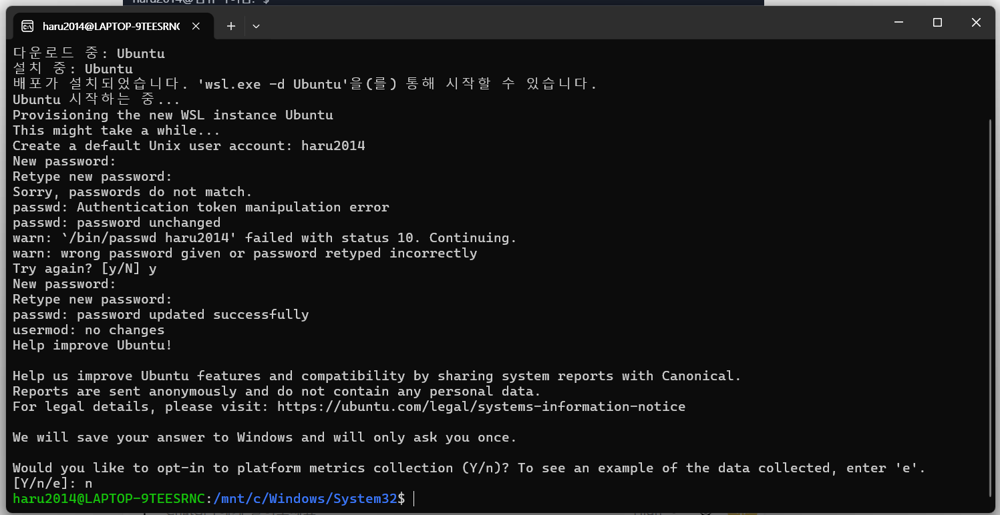 |
| **디렉터리 생성 및 경로 확인** | `mkdir my-dev-workspace`, `cd`, `pwd`, `ls -la` | 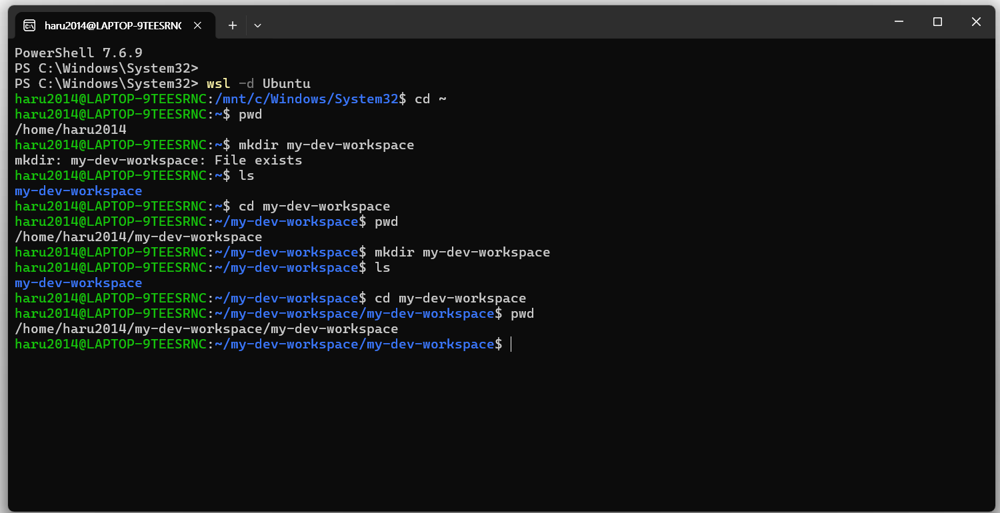 |
| **파일 생성 및 내용 조회** | `touch practice.txt`, `echo >`, `cat` | 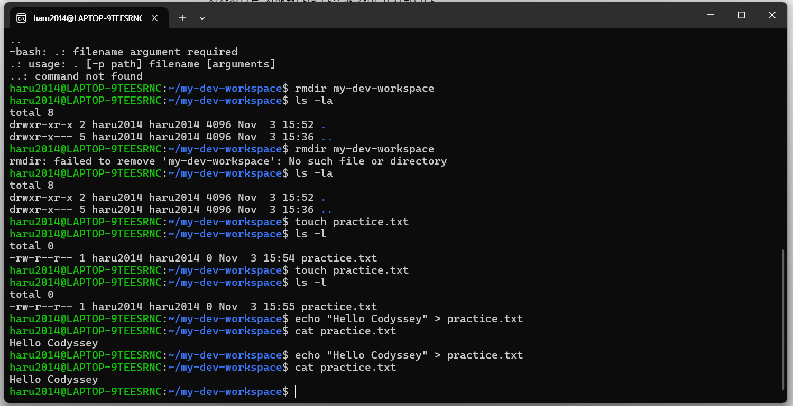 |
| **파일 복사 및 목록 확인** | `cp practice.txt practice-copy.txt`, `ls -l` | 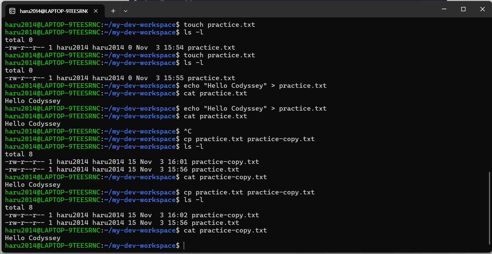 |
| **이름 변경 및 대화형 삭제** | `mv`, `rm -i practice-backup.txt` | 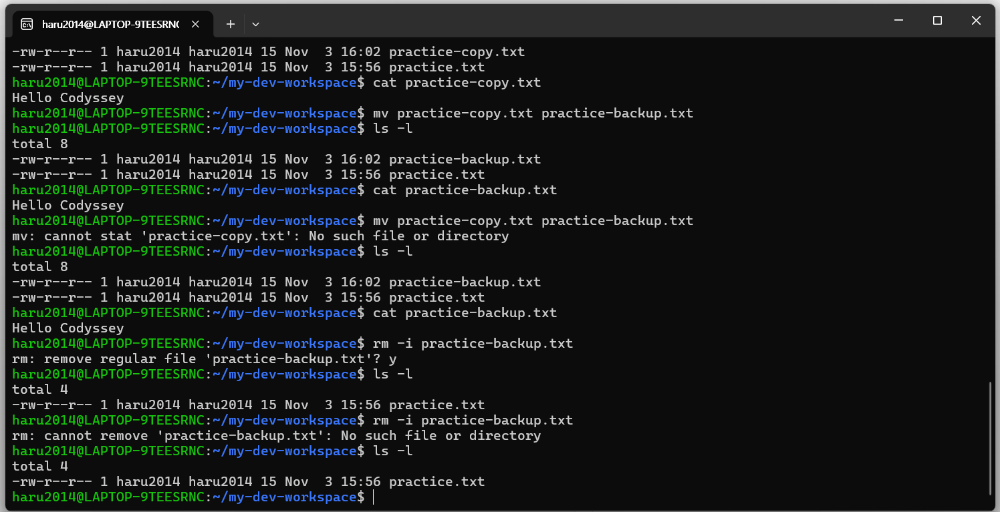 |

---

### 6.2 파일 및 디렉터리 권한(Permission) 제어 실습

파일과 디렉터리에 대해 `chmod`를 이용한 권한 변경 실험을 수행하고 전/후 상태를 비교 검증했습니다.

```bash
# 파일 권한 실습: 600(소유자만 읽기/쓰기) <-> 644(전체 읽기 허용)
chmod 600 practice.txt && ls -l practice.txt
# 출력: -rw------- 1 haru2014 haru2014 15 Nov 3 15:56 practice.txt

chmod 644 practice.txt && ls -l practice.txt
# 출력: -rw-r--r-- 1 haru2014 haru2014 15 Nov 3 15:56 practice.txt

# 디렉터리 권한 실습: 700(소유자 전용) <-> 755(표준 접근 허용)
mkdir permission-test
chmod 700 permission-test && ls -ld permission-test
# 출력: drwx------ 2 haru2014 haru2014 4096 Nov 3 16:18 permission-test

chmod 755 permission-test && ls -ld permission-test
# 출력: drwxr-xr-x 2 haru2014 haru2014 4096 Nov 3 16:18 permission-test
```

| 검증 단계 | 수행 내용 | 증빙 스크린샷 |
|---|---|:---:|
| **파일 권한 600 변경** | `chmod 600 practice.txt` (`-rw-------` 확인) | 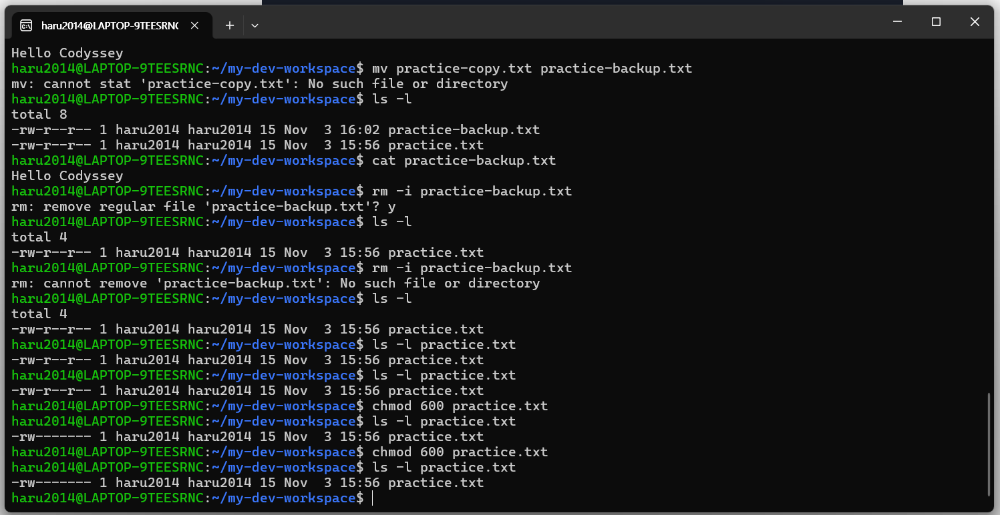 |
| **파일 권한 644 복구** | `chmod 644 practice.txt` (`-rw-r--r--` 확인) | 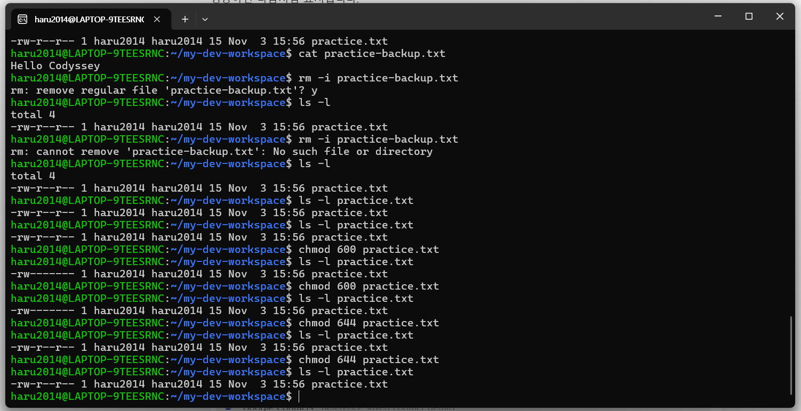 |
| **디렉터리 권한 700 변경** | `chmod 700 permission-test` (`drwx------` 확인) | 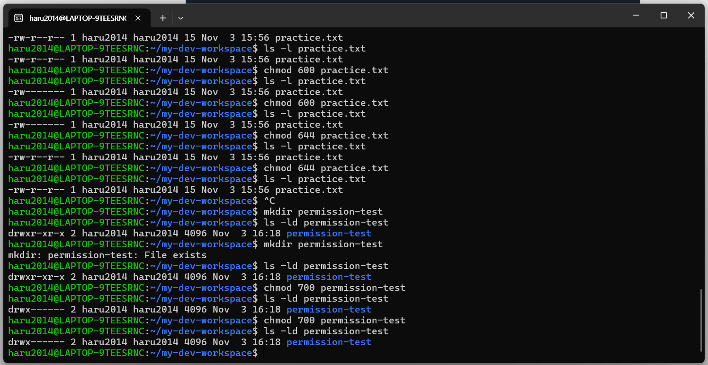 |
| **디렉터리 권한 755 복구** | `chmod 755 permission-test` (`drwxr-xr-x` 확인) | 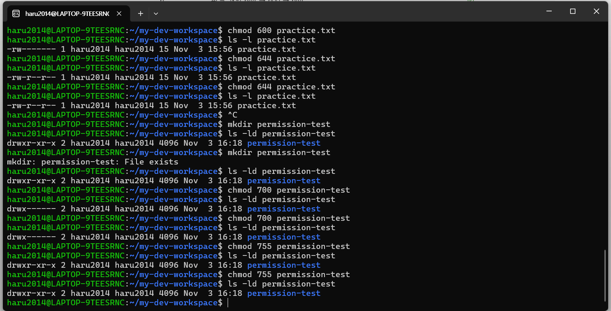 |

---

### 6.3 Docker 데몬 점검 및 컨테이너 기본 운영

Docker Desktop 엔진의 상태를 점검하고 컨테이너 기본 라이프사이클 명령어를 실행했습니다.

```bash
# Docker 버전 및 데몬 정보 확인
docker --version
# Docker version 29.9.2, build a82e528
docker info

# hello-world 컨테이너 실행
docker run hello-world

# 이미지 및 컨테이너 목록 조회
docker images
docker ps -a

# ubuntu 컨테이너 인터랙티브 진입 및 종료 관찰
docker start mybox
docker exec -it mybox bash
# (내부에서 pwd, ls, echo 실행 후 exit)
docker ps          # exec 종료 후에도 컨테이너가 계속 유지됨을 확인
docker stop mybox  # 명시적 컨테이너 중지
```

| 검증 단계 | 수행 내용 | 증빙 스크린샷 |
|---|---|:---:|
| **Docker 버전 확인** | `docker --version` (버전 29.9.2 확인) | 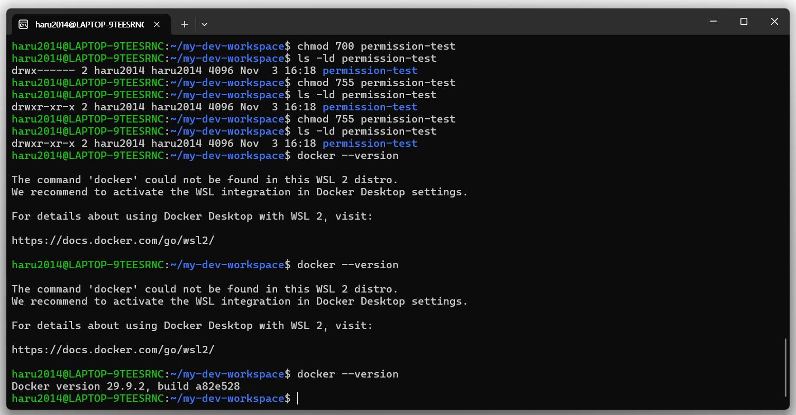 |
| **Docker 데몬 정상 구동** | `docker info` (엔진 정상 연결 확인) | 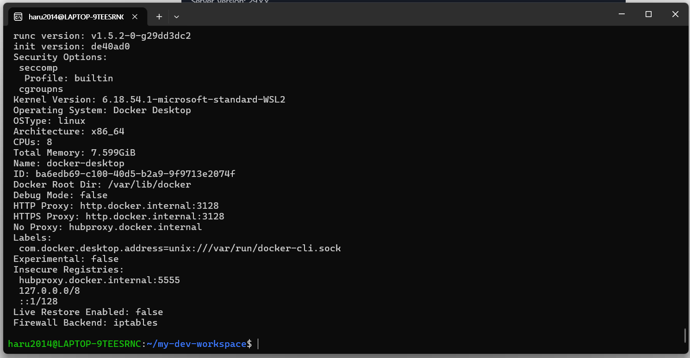 |
| **hello-world 검증** | `docker run hello-world` 성공 메시지 출력 | 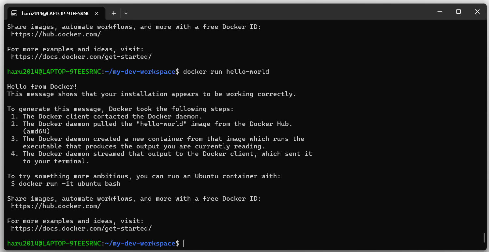 |
| **컨테이너 목록 확인** | `docker ps -a` (종료 및 실행 컨테이너 상태) | 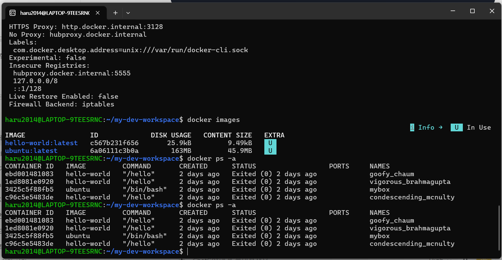 |
| **컨테이너 내부 진입** | `docker exec -it mybox bash` 및 내부 명령 수행 | 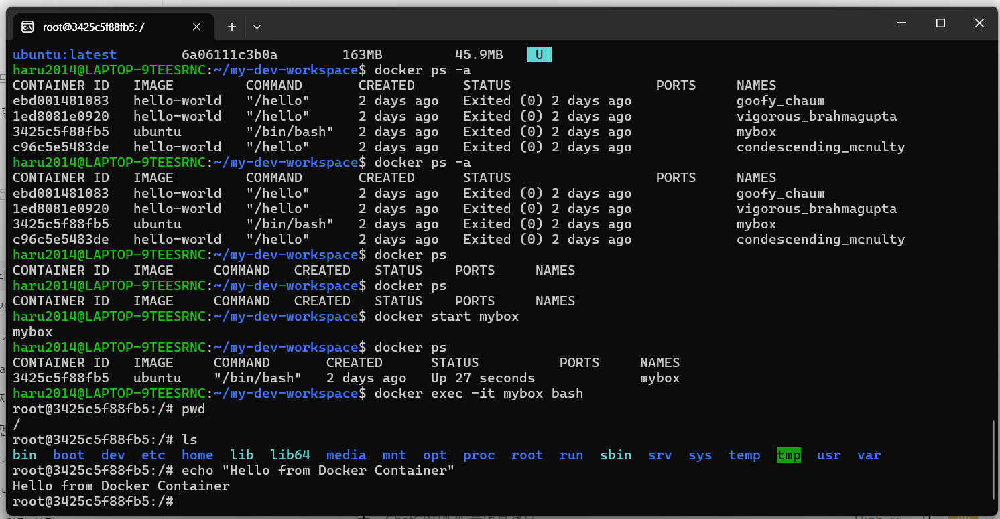 |
| **리소스 상태 모니터링** | `docker stats --no-stream mybox` (CPU/메모리) | 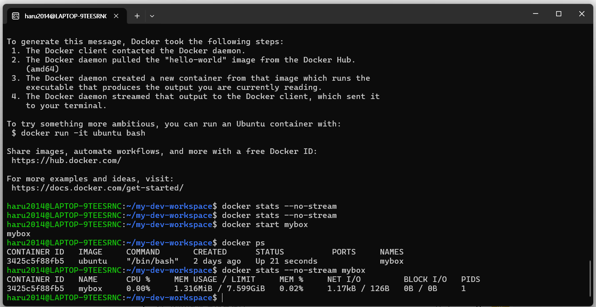 |

---

### 6.4 Dockerfile 기반 커스텀 웹 서버 빌드 및 포트 매핑

경량 Nginx 이미지에 커스텀 HTML 페이지를 탑재하여 빌드하고, 복수의 포트(`8080`, `8081`)로 매핑하여 접속을 검증했습니다.

#### Dockerfile 코드
```dockerfile
FROM nginx:alpine
LABEL org.opencontainers.image.title="My Dev Workspace"
COPY site/ /usr/share/nginx/html/
EXPOSE 80
```

#### 빌드 및 실행 명령어
```bash
# 이미지 빌드
docker build -t my-dev-web:1.0 .

# 8080 포트 컨테이너 기동
docker run -d --name my-web-8080 -p 127.0.0.1:8080:80 my-dev-web:1.0

# 8081 포트 컨테이너 기동 (다중 포트 매핑 검증)
docker run -d --name my-web-8081 -p 127.0.0.1:8081:80 my-dev-web:1.0
```

| 검증 단계 | 수행 내용 | 증빙 스크린샷 |
|---|---|:---:|
| **Dockerfile 및 HTML 작성** | `site/index.html` 및 `Dockerfile` 명세 작성 | 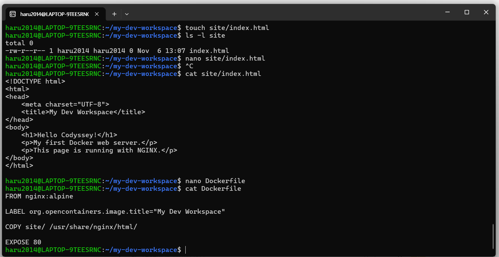 |
| **커스텀 이미지 빌드** | `docker build -t my-dev-web:1.0 .` 레이어 빌드 성공 | 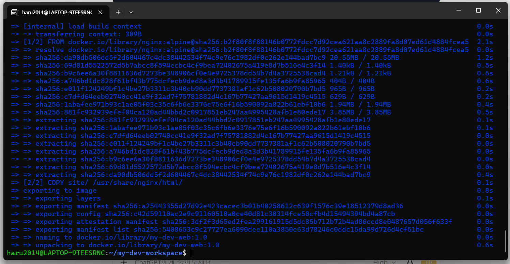 |
| **8080 포트 매핑 실행** | `-p 127.0.0.1:8080:80` 컨테이너 백그라운드 구동 | 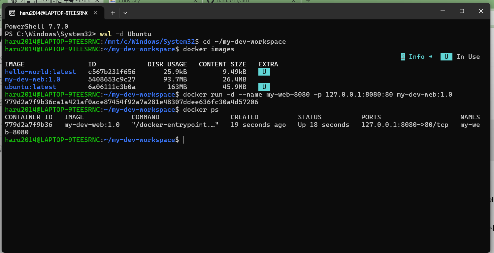 |
| **8080 브라우저 접속 성공** | `http://localhost:8080` 접속 증빙 (주소창 포함) | 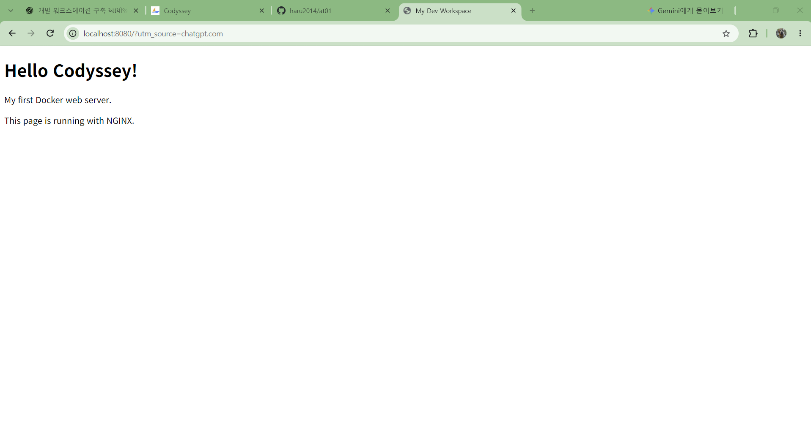 |
| **8081 포트 매핑 실행** | `-p 127.0.0.1:8081:80` 컨테이너 추가 구동 | 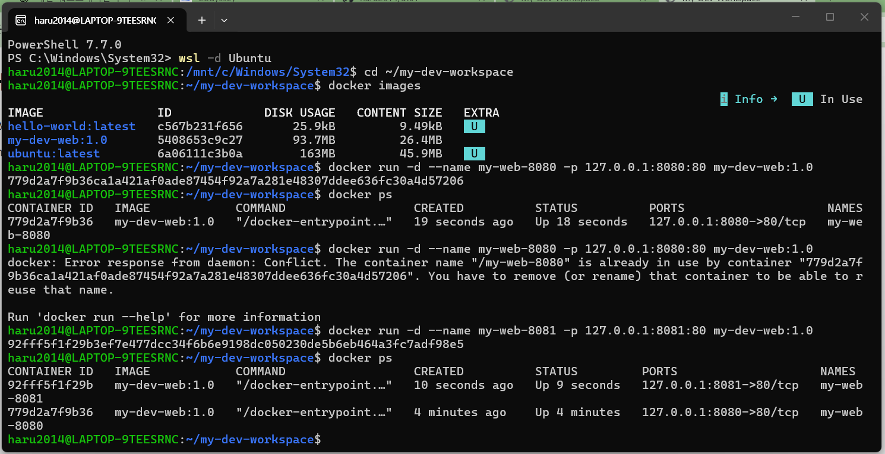 |
| **8081 브라우저 접속 성공** | `http://localhost:8081` 접속 증빙 (주소창 포함) | 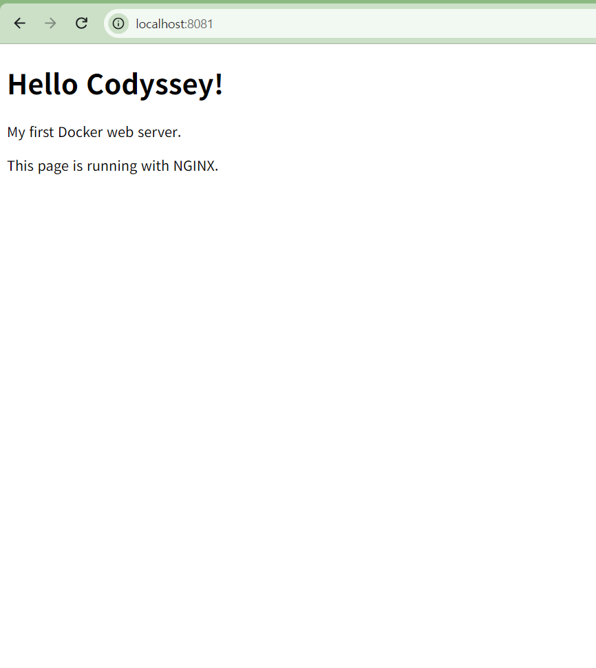 |

---

### 6.5 바인드 마운트(Bind Mount) 실시간 코드 반영 검증

호스트의 소스 폴더(`$(pwd)/site`)를 컨테이너의 문서 루트(`/usr/share/nginx/html`)로 바인드 마운트하여, 컨테이너 재빌드 없이 코드 수정이 즉시 웹에 반영됨을 입증했습니다.

```bash
# 1. 바인드 마운트 컨테이너 실행 (8082 포트)
docker run -d --name web-mount -p 127.0.0.1:8082:80 \
  --mount type=bind,source="$(pwd)/site",target=/usr/share/nginx/html,readonly my-dev-web:1.0

# 2. 호스트 파일 내용 수정 (nano 에디터 사용)
# <h1>Hello Codyssey! Bind Mount Updated!</h1> 로 수정

# 3. 브라우저 새로고침을 통해 변경 사항 즉시 확인
```

| 검증 단계 | 수행 내용 | 증빙 스크린샷 |
|---|---|:---:|
| **바인드 마운트 컨테이너 구동** | `--mount type=bind`를 적용하여 8082 포트로 기동 | 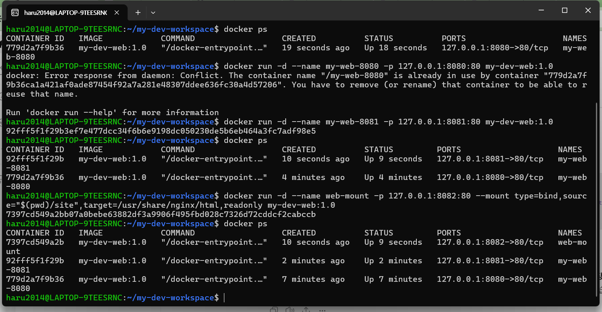 |
| **호스트 코드 수정** | `nano site/index.html`로 제목 문구 수정 | 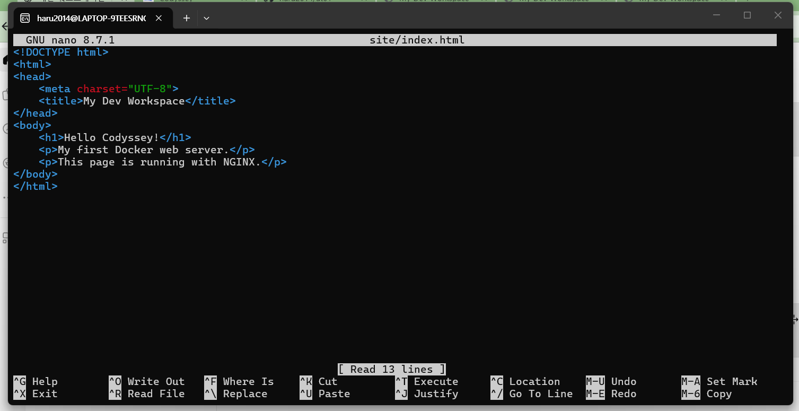 |
| **실시간 반영 브라우저 검증** | `localhost:8082` 새로고침 시 "Bind Mount Updated!" 즉시 반영 | 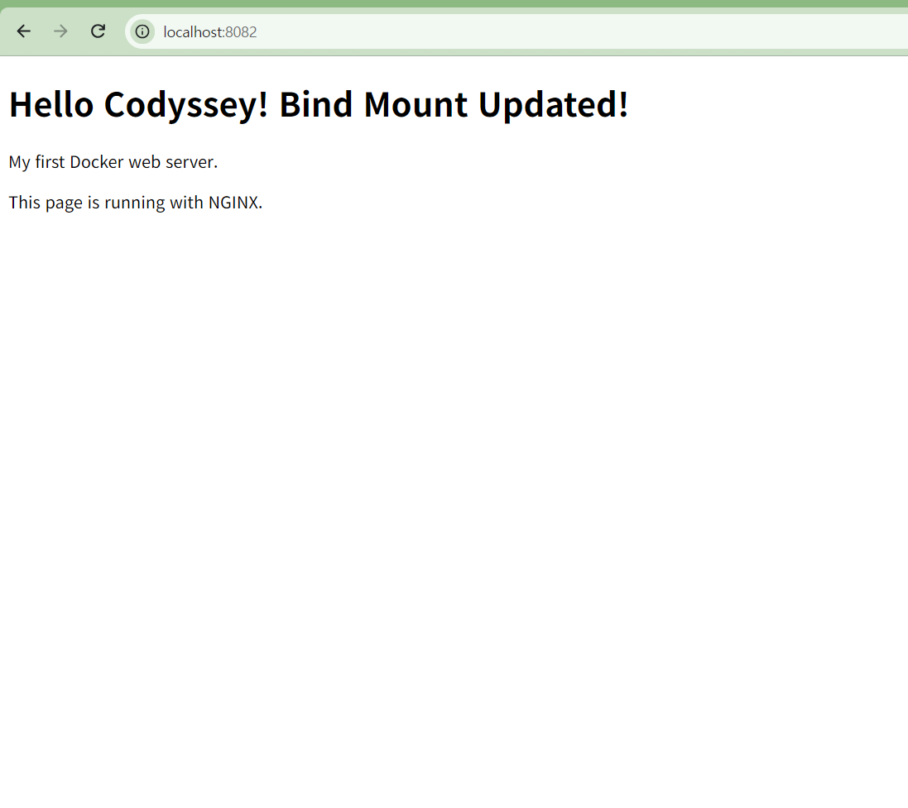 |

---

### 6.6 Docker 볼륨(Volume) 영속성 검증

Docker 볼륨을 생성하여 1번 컨테이너에 마운트한 뒤 파일을 생성하고, 해당 컨테이너를 강제 삭제(`docker rm -f`)한 후 2번 컨테이너에서 동일 볼륨을 연결하여 데이터가 완벽히 보존됨을 증명했습니다.

```bash
# 1. Docker Volume 생성 및 확인
docker volume create codyssey-data
docker volume ls

# 2. 1번 컨테이너 생성 및 볼륨 데이터 작성
docker run -d --name volume-test-1 -v codyssey-data:/data ubuntu:latest sleep infinity
docker exec volume-test-1 sh -c 'echo "Hello Codyssey Volume" > /data/test.txt'
docker exec volume-test-1 cat /data/test.txt
# 출력: Hello Codyssey Volume

# 3. 1번 컨테이너 강제 삭제 (파괴)
docker rm -f volume-test-1

# 4. 2번 신규 컨테이너 생성 및 기존 볼륨 연결
docker run -d --name volume-test-2 -v codyssey-data:/data ubuntu:latest sleep infinity

# 5. 데이터 보존 여부 검증
docker exec volume-test-2 cat /data/test.txt
# 출력: Hello Codyssey Volume (완벽 보존 확인!)
```

| 검증 단계 | 수행 내용 | 증빙 스크린샷 |
|---|---|:---:|
| **Docker 볼륨 생성** | `docker volume create codyssey-data` 및 `docker volume ls` | 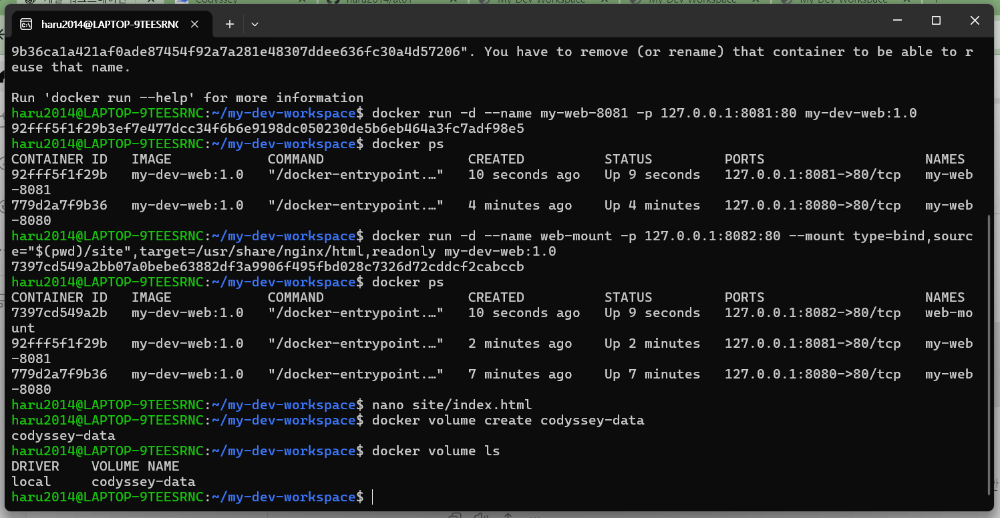 |
| **1번 컨테이너 데이터 작성** | `/data/test.txt`에 "Hello Codyssey Volume" 기록 및 확인 | 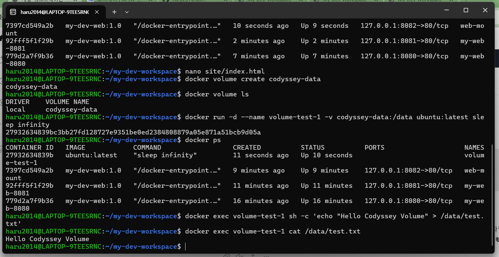 |
| **컨테이너 삭제 후 복원 검증** | `docker rm -f` 후 2번 컨테이너에서 동일 데이터 보존 확인 | 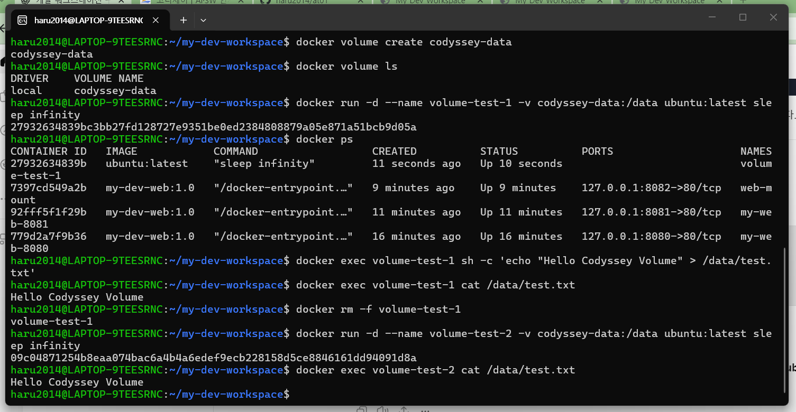 |

---

## 7. 트러블슈팅 보고서 (Troubleshooting Report)

### 📌 [사례 1] WSL 2 내 Docker 데몬 소켓 권한 거부 오류

- **문제 현상**: WSL 터미널에서 `docker info` 실행 시 데몬에 연결하지 못하고 권한 오류 발생 (`과제19.png`)
  ```text
  Server:
  permission denied while trying to connect to the docker API at unix:///var/run/docker.sock
  ```
- **원인 가설**:
  1. Docker 데몬의 UNIX 도메인 소켓(`/var/run/docker.sock`)은 `root:docker` 소유로 생성됨.
  2. 현재 로그인 계정(`haru2014`)이 `docker` 사용자 그룹에 등록되어 있지 않아 접근 권한(소유그룹 권한)이 없음.
- **확인 및 검증**:
  - `ls -l /var/run/docker.sock` 조회 결과 권한이 `srw-rw---- 1 root docker`로 설정되어 있음을 확인 (`과제20.png`).
  - `groups` 명령어 실행 결과 `haru2014 adm cdrom sudo dip plugdev users`로 `docker` 그룹이 누락되어 있음을 확인 (`과제21.png`).
- **해결 조치**:
  1. 사용자 계정을 `docker` 그룹에 추가: `sudo usermod -aG docker haru2014` (`과제22.png`)
  2. 그룹 변경 사항을 세션에 즉시 적용하기 위해 WSL 세션 재시작 (`exit` 후 `wsl -d Ubuntu` 재진입)
  3. `groups` 명령어로 `docker` 그룹 포함 여부 재확인 (`과제24.png`)
  4. `docker info` 및 `docker run hello-world` 실행 결과 정상 연결 성공 확인 (`과제25.png`, `과제26.png`)
- **배운 점**: Linux의 권한 모델과 데몬 소켓 통신 메커니즘을 이해하고, 그룹 권한 변경 후 프로세스 세션 갱신의 중요성을 체득함.

---

### 📌 [사례 2] GitHub 원격 푸시 거부 오류 (`non-fast-forward / unrelated histories`)

- **문제 현상**: 로컬 `at01` 저장소에서 `git commit` 후 `git push -u origin main` 실행 시 푸시가 거부됨.
  ```text
  To github.com:haru2014/at01.git
   ! [rejected]        main -> main (non-fast-forward)
  error: failed to push some refs to 'github.com:haru2014/at01.git'
  hint: Updates were rejected because the tip of your current branch is behind its remote counterpart.
  ```
- **원인 가설**:
  - GitHub 웹에서 `at01` 저장소를 생성할 때 "Add a README file" 옵션이 체크되어 원격에 이미 초기 커밋(`f985cbd Initial commit`)이 생성되어 있었음.
  - 로컬에서는 `git init`으로 새 저장소를 만들어 독립적인 첫 커밋(`4a46235`)을 생성했기 때문에, 두 커밋의 공통 조상이 없어 Fast-Forward 병합이 불가능함.
- **확인 및 검증**:
  - `git ls-remote origin` 및 `git fetch origin`을 통해 원격 `origin/main`의 커밋 히스토리를 확인.
  - `git merge-base origin/main main` 확인 결과 공통 부모 커밋이 없음을 확인.
- **해결 조치**:
  1. 원격의 최신 커밋을 기반으로 로컬 커밋을 재정렬하기 위해 `git rebase origin/main` 수행.
  2. 원격의 `README.md` 커밋 위에 로컬의 파일 추가 커밋이 충돌 없이 깔끔하게 얹어짐 (`Successfully rebased and updated refs/heads/main`).
  3. `git push -u origin main`을 실행하여 선형 히스토리로 원격 저장소에 성공적으로 푸시 완료.
- **배운 점**: 이미 파일이 존재하는 원격 저장소와 로컬 저장소를 연동할 때는 단순 푸시가 불가하며, `rebase` 전략을 통해 히스토리를 정렬하는 방식을 습득함.

---

### 📌 [사례 3] 컨테이너 이름 중복 충돌 (`Container name already in use`)

- **문제 현상**: `46.png` 실습 중 동일한 이름으로 컨테이너를 실행하려 하자 충돌 오류 발생
  ```text
  docker: Error response from daemon: Conflict. The container name "/my-web-8080" is already in use by container "...". You have to remove (or rename) that container to be able to reuse that name.
  ```
- **원인 분석**: 이미 `my-web-8080`이라는 고유 네임으로 8080 포트 컨테이너가 실행 중인 상태에서 동일한 이름을 지정함.
- **해결 조치**: 두 번째 컨테이너의 이름을 목적에 맞게 `my-web-8081`로 명확히 분리하고 호스트 포트도 `8081`로 지정하여 정상 구동 완료.

---

## 8. 재현 가이드 (How to Reproduce)

평가자 또는 동료가 본 프로젝트를 로컬 환경에서 동일하게 실행하고 재현하는 방법입니다.

```bash
# 1. 저장소 복제 및 이동
git clone git@github.com:haru2014/at01.git
cd at01

# 2. 커스텀 웹 서버 이미지 빌드
docker build -t my-dev-web:1.0 .

# 3. 포트 매핑으로 컨테이너 실행
docker run -d --name my-web-8080 -p 8080:80 my-dev-web:1.0

# 4. 브라우저에서 접속 확인
# 웹 브라우저 주소창에 http://localhost:8080 접속 -> "Hello Codyssey!" 확인

# 5. 바인드 마운트 실시간 개발 환경 실행
docker run -d --name web-mount -p 8082:80 -v $(pwd)/site:/usr/share/nginx/html my-dev-web:1.0
```

---

## 9. 보안 및 개인정보 보호 준수

- GitHub 원격 저장소에 푸시되는 모든 커밋 로그 및 본 기술 문서에서 GitHub Personal Access Token(PAT), 개인 SSH Private Key 및 시스템 비밀번호를 철저히 배제 및 마스킹 처리했습니다.
- `.gitignore`를 통해 운영체제 임시 파일 및 불필요한 메타데이터가 추적되지 않도록 관리했습니다.
