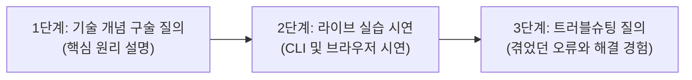

# [미션 01] 동료평가 대비 완벽 가이드북

본 문서는 **코디세이 미션 01 (내 컴퓨터에 개발자용 '작업실' 꾸미기)** 동료평가를 받을 때, 동료 평가자의 질문에 막힘없이 답변하고 라이브 시연을 성공적으로 마칠 수 있도록 정리한 **핵심 대비 가이드**입니다.

---

## 📌 동료평가 진행 프로세스 및 대비 전략

동료평가는 보통 아래의 3단계 흐름으로 진행됩니다:



1. **개념 구술**: "왜 그렇게 설정했는지", "두 개념의 차이가 무엇인지"를 핵심 키워드 중심으로 답변합니다.
2. **화면 시연**: 요청받은 명령어를 터미널에서 신속하게 시연하고 출력과 브라우저 화면을 보여줍니다.
3. **트러블슈팅 공유**: 실습 중 실제로 겪었던 문제(`docker.sock` 권한 거부, Git 푸시 충돌)와 해결 과정을 자신 있게 설명합니다.

---

## 1. 핵심 개념 구술 평가 대비 (100% 빈출 질문 & 모범 답변)

### Q1. 절대 경로(Absolute Path)와 상대 경로(Relative Path)의 차이는 무엇인가요?
* **답변 포인트**:
  * **절대 경로**: 최상위 루트 디렉터리(`/` 또는 `C:\`)부터 시작하여 대상의 고유한 전체 위치를 명시하는 경로입니다. 현재 위치(`pwd`)가 어디든 항상 동일한 대상을 가리킵니다.
    * *예시*: `/home/haru2014/my-dev-workspace/site/index.html`
  * **상대 경로**: 현재 작업 디렉터리(`.` 또는 `pwd`)를 기준으로 대상을 표현하는 경로입니다.
    * *예시*: `./site/index.html` (현재 폴더의 site), `../practice.txt` (상위 폴더의 practice.txt)
  * **협업/이식성 관점의 중요성**: 팀 프로젝트나 Dockerfile, 스크립트 작성 시 특정 개인 PC 경로(`/home/haru2014/...`)를 절대 경로로 하드코딩하면 다른 동료 PC에서 동작하지 않으므로, **재현성을 위해 상대 경로 사용이 필수적**입니다.

---

### Q2. 파일 권한 `r/w/x`와 `755`, `644`, `600` 표기는 어떻게 계산되고 왜 쓰이나요?
* **답변 포인트**:
  * 권한은 읽기(`r`=4), 쓰기(`w`=2), 실행(`x`=1)의 3비트 8진수 합산이며, **소유자(User) / 소유그룹(Group) / 기타사용자(Others)** 순서로 표기됩니다.
  * **`755` (`rwxr-xr-x`)**:
    * 소유자 `7`(`rwx`, 읽기/쓰기/실행), 그룹 `5`(`r-x`, 읽기/실행), 기타 `5`(`r-x`, 읽기/실행)
    * **적용 대상**: 디렉터리(내부에 들어가려면 실행 `x` 권한 필수) 및 실행 가능한 쉘 스크립트
  * **`644` (`rw-r--r--`)**:
    * 소유자 `6`(`rw-`, 읽기/쓰기), 그룹 `4`(`r--`, 읽기 전용), 기타 `4`(`r--`, 읽기 전용)
    * **적용 대상**: 일반 텍스트 문서, HTML/CSS 정적 파일, 소스코드 (실행 권한이 필요 없는 파일)
  * **`600` (`rw-------`)**:
    * 소유자만 읽고 쓸 수 있으며, 외부인은 일체 접근 불가
    * **적용 대상**: SSH 개인키(`id_rsa`), GitHub 토큰 파일, 비밀번호 등 민감 보안 파일
  * **[보너스 꼬리질문] 특수 권한 비트**:
    * **SetUID(4000)**: 일반 사용자가 실행해도 소유자 권한으로 동작 (예: `passwd` 명령어)
    * **Sticky Bit(1000)**: 공용 폴더(`/tmp`)에서 누구나 파일을 만들 수 있지만, 파일 삭제는 작성자 본인만 가능하게 제한

---

### Q3. 기존 Dockerfile 기반 커스텀 이미지 제작 원리와 이미지 vs 컨테이너의 차이는?
* **답변 포인트**:
  * **제작 원리**: 공식 이미지(`FROM nginx:alpine`)를 기반으로 필요한 소스코드(`COPY site/ /usr/share/nginx/html/`)와 메타데이터(`LABEL`, `EXPOSE 80`)를 명령어 단위로 한 층씩 쌓아(Layer) 새로운 불변 이미지를 빌드합니다.
  * **이미지 (Image)**: 코드, 런타임, 라이브러리가 불변(Immutable) 상태로 묶인 **실행 템플릿(설계도)**입니다.
  * **컨테이너 (Container)**: 이미지 레이어 위에 얇은 **읽기/쓰기 레이어(Thin R/W Layer)**를 얹어 메모리상에 격리 실행된 **인스턴스(실체)**입니다.
  * **불변성 증명**: 컨테이너 안에서 파일을 수정하거나 삭제해도 원본 이미지는 전혀 손상되지 않으며, 새로운 컨테이너를 실행하면 언제나 초기 상태의 이미지가 깨끗하게 기동됩니다.

---

### Q4. 포트 매핑(Port Forwarding)이 필요한 이유와 `127.0.0.1` vs `0.0.0.0`의 차이는?
* **답변 포인트**:
  * **필요성**: 컨테이너는 호스트 OS와 네트워크 네임스페이스가 분리되어 사설 가상 IP를 가집니다. 외부(호스트 웹 브라우저)에서 컨테이너 내부 서비스(80번 포트)에 접속하려면 호스트의 특정 포트로 들어온 요청을 컨테이너 내부로 전달해 주는 포트 포워딩(`-p <호스트포트>:<컨테이너포트>`)이 반드시 필요합니다.
  * **호스트 바인딩 주소 차이**:
    * `-p 127.0.0.1:8080:80` (로컬 루프백): 내 PC 내부에서만 접속 허용. 외부 해킹이나 LAN 상의 다른 사용자 접속을 차단하여 로컬 개발 시 가장 안전함.
    * `-p 0.0.0.0:8080:80` (모든 인터페이스): 로컬뿐 아니라 외부 네트워크에서도 접속 가능. 실 서비스 배포에 사용되며 방화벽 설정 필수.

---

### Q5. Docker Volume(영속 데이터)과 바인드 마운트(Bind Mount)의 차이는 무엇인가요?
* **답변 포인트**:
  * **컨테이너 자체의 특성**: 컨테이너는 기본적으로 Stateless(상태 없음) 구조로, 컨테이너를 삭제(`docker rm`)하면 내부 데이터는 영구 소멸됩니다.
  * **Docker Volume (영속성 보존)**:
    * Docker 엔진이 자체 관리하는 호스트 저장 영역(`/var/lib/docker/volumes/`)에 볼륨을 생성.
    * 컨테이너가 파괴되어도 볼륨은 삭제되지 않으며, 다른 컨테이너에 재연결하여 영구적으로 데이터를 유지함. (주로 DB 데이터 저장에 사용)
  * **바인드 마운트 (실시간 개발 편의성)**:
    * 호스트의 특정 폴더(`$(pwd)/site`)를 컨테이너 내부(`/usr/share/nginx/html`)와 1:1로 직접 연결.
    * 호스트에서 HTML/코드를 수정하면 이미지를 다시 빌드(`docker build`)하지 않아도 브라우저 새로고침만으로 즉시 변경 사항이 반영됨. (주로 로컬 코드 개발 시 사용)

---

### Q6. Git과 GitHub의 차이는 무엇인가요?
* **답변 포인트**:
  * **Git**: 내 로컬 컴퓨터에서 코드의 변경 이력(Commit)을 기록하고 브랜치 분기 및 병합을 수행하는 **분산 버전 관리 시스템(DVCS 소프트웨어 도구)**입니다.
  * **GitHub**: Git으로 기록된 로컬 저장소를 클라우드 원격지에 호스팅하여 백업, 팀 협업, 코드 리뷰(PR), 이슈 관리, CI/CD 배포를 가능하게 해주는 **웹 기반 협업 플랫폼**입니다.

---

## 2. 라이브 시연(Live Demo) 치트시트

평가자가 *"직접 터미널에서 실행해 보세요"*라고 요구할 경우 사용하는 명령어 요약표입니다.

### 2.1 터미널 CLI & 권한 조작 시연
```bash
# 1. 경로 확인 및 디렉터리 생성
pwd
mkdir -p test_folder && cd test_folder

# 2. 파일 생성 및 내용 기록
touch demo.txt && echo "Live Demo" > demo.txt && cat demo.txt

# 3. 권한 변경 (600 -> 644)
ls -l demo.txt           # 기본 권한 확인
chmod 600 demo.txt       # 소유자 전용 읽기/쓰기 (-rw-------)
ls -l demo.txt
chmod 644 demo.txt       # 전체 읽기 허용 복원 (-rw-r--r--)
ls -l demo.txt
```

### 2.2 Docker 컨테이너 & 커스텀 이미지 빌드 시연
```bash
# 1. Docker 데몬 상태 확인
docker --version
docker info

# 2. 이미지 및 컨테이너 목록 확인
docker images
docker ps -a

# 3. 커스텀 웹 서버 빌드 및 실행
docker build -t my-dev-web:1.0 .
docker run -d --name my-web-8080 -p 8080:80 my-dev-web:1.0
docker ps

# 4. 접속 확인 (CLI curl 또는 웹 브라우저 http://localhost:8080)
curl -i http://localhost:8080
```

### 2.3 바인드 마운트 실시간 반영 시연
```bash
# 1. 바인드 마운트로 8082 포트 실행
docker run -d --name web-mount -p 8082:80 -v $(pwd)/site:/usr/share/nginx/html my-dev-web:1.0

# 2. 호스트에서 HTML 수정
echo "<h1>Live Demo Bind Mount Updated!</h1>" > site/index.html

# 3. 브라우저에서 http://localhost:8082 새로고침 -> 이미지 재빌드 없이 즉시 반영 확인!
```

### 2.4 Docker 볼륨 데이터 영속성 시연
```bash
# 1. 볼륨 생성
docker volume create codyssey-data

# 2. 1번 컨테이너에 마운트 후 파일 작성
docker run -d --name volume-test-1 -v codyssey-data:/data ubuntu:latest sleep infinity
docker exec volume-test-1 sh -c 'echo "Data Persists!" > /data/test.txt'
docker exec volume-test-1 cat /data/test.txt

# 3. 1번 컨테이너 강제 삭제 (파괴!)
docker rm -f volume-test-1

# 4. 2번 신규 컨테이너에 동일 볼륨 연결 후 데이터 확인
docker run -d --name volume-test-2 -v codyssey-data:/data ubuntu:latest sleep infinity
docker exec volume-test-2 cat /data/test.txt
# -> "Data Persists!"가 그대로 출력됨을 보여주면 시연 성공!
```

---

## 3. 트러블슈팅 경험 구술 대비 (실제 겪은 사례 3가지)

평가자가 *"실습하면서 어떤 에러를 만났고 어떻게 해결했나요?"*라고 질문할 때 완벽하게 설명하는 가이드입니다.

### [사례 1] WSL 2 환경에서 Docker 데몬 소켓 권한 거부 (`docker.sock: permission denied`)
* **문제 상황**: WSL Ubuntu에서 `docker info` 실행 시 소켓 권한 거부 에러 발생 (`과제19.png`).
* **원인**: `/var/run/docker.sock` 소켓 파일의 소유 그룹이 `docker`인데, 현재 로그인한 `haru2014` 계정이 `docker` 그룹에 속해있지 않아 접근 불가.
* **해결 방법**:
  1. `sudo usermod -aG docker haru2014` 명령어로 계정을 docker 그룹에 추가.
  2. 세션에 변경된 그룹 권한을 반영하기 위해 WSL 세션을 재시작(`exit` 후 재진입).
  3. `groups` 명령어로 `docker` 그룹 포함을 확인한 뒤 `docker info` 및 `hello-world` 정상 실행 완료.

### [사례 2] GitHub 원격 푸시 거부 (`non-fast-forward / unrelated histories`)
* **문제 상황**: 로컬에서 `git init` 후 커밋한 뒤 `git push -u origin main`을 실행했을 때 푸시가 거부됨.
* **원인**: GitHub 웹에서 저장소를 만들 때 README 파일이 자동 생성되어 원격에 이미 초기 커밋(`f985cbd`)이 존재했고, 로컬의 초기 커밋과 뿌리(Root)가 달라 Git이 병합을 거부함.
* **해결 방법**:
  1. `git fetch origin`으로 원격 이력을 수신.
  2. `git rebase origin/main`을 실행하여 원격의 초기 커밋 위에 로컬 커밋들을 선형으로 깔끔하게 재배치.
  3. `git push -u origin main`으로 충돌 없이 푸시 완료.

### [사례 3] 포트 충돌 및 컨테이너 이름 중복 (`Conflict: container name already in use`)
* **문제 상황**: `46.png` 실습 중 동일한 이름(`my-web-8080`)으로 새 컨테이너를 기동하려 하자 충돌 에러 발생.
* **해결 방법**: 두 번째 컨테이너의 이름을 목적에 맞게 `my-web-8081`로 지정하고 호스트 포트도 `8081`로 분리하여 정상 실행.
* **포트 충돌 진단 노하우**: `ss -tulpn | grep :8080` 또는 Windows `Get-NetTCPConnection`으로 점유 프로세스(PID)를 진단하고 종료하거나, `8888` 등 대체 포트를 활용하는 절차를 숙지함.

---

## 4. 꼬리 질문(Deep Dive) 대비 핵심 문답

| 질문 | 핵심 모범 답변 |
|---|---|
| **왜 Nginx의 `alpine` 버전을 썼나요?** | `alpine`은 경량화된 보안 중심 리눅스 배포판으로, 이미지 용량이 약 20~40MB 수준으로 매우 작아 다운로드와 배포가 빠르고 불필요한 패키지가 없어 보안 공격 표면(Attack Surface)이 최소화되기 때문입니다. |
| **Dockerfile의 `EXPOSE 80`을 쓰면 포트가 자동으로 열리나요?** | 아닙니다. `EXPOSE`는 컨테이너가 해당 포트를 사용한다는 것을 명시하는 **문서화(Documentation) 용도**이며, 호스트에서 실제로 접근하려면 컨테이너 실행 시 `-p <호스트포트>:<컨테이너포트>` 옵션을 지정해야만 포트 포워딩이 이루어집니다. |
| **`docker exec`와 `docker attach`의 차이는 무엇인가요?** | `attach`는 컨테이너의 주 프로세스(PID 1)의 입출력에 직접 연결되므로 여기서 `exit`을 누르면 컨테이너 자체가 종료됩니다. 반면 `docker exec`는 이미 실행 중인 컨테이너 내부에 **새로운 별도의 쉘 프로세스를 추가로 실행**하므로 `exit`으로 빠져나와도 컨테이너는 계속 실행 상태를 유지합니다. |
| **볼륨 데이터를 백업하려면 어떻게 해야 하나요?** | Docker Volume은 호스트 격리 영역에 있으므로, 임시 컨테이너에 해당 볼륨과 호스트 현재 폴더를 마운트한 뒤 `tar cvf /backup/volume.tar -C /data .` 명령어로 압축 파일을 생성하여 호스트로 안전하게 추출합니다. |
| **`.gitignore` 파일의 역할은 무엇인가요?** | Git이 추적하지 말아야 할 파일 목록을 지정하는 파일로, OS 임시 파일(`Thumbs.db`, `.DS_Store`)이나 에디터 설정(`.vscode`), 그리고 무엇보다 **API 토큰, 개인키(`id_rsa`), 패스워드 등 민감 정보가 GitHub에 유출되는 것을 사전에 방지**하기 위해 필수적입니다. |

---

## 5. 최종 점검 체크리스트 (평가 시작 5분 전 확인)

- [ ] Docker Desktop이 실행 중이며 초록색 정상 상태인지 확인
- [ ] 브라우저에서 `https://github.com/haru2014/at01` 저장소에 `README.md`, `Dockerfile`, `site/`, `스샷/` 폴더가 정상 노출되는지 확인
- [ ] 터미널에서 `cd ~/my-dev-workspace` 이동 후 `docker ps` 및 `docker images` 실행 준비 완료
- [ ] 긴장하지 않고 "원리와 이유"를 당당하게 설명하기!
